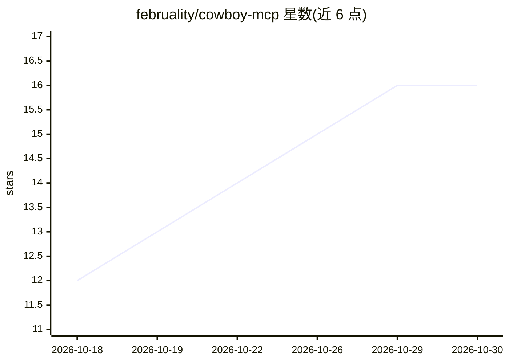

# februality/cowboy-mcp

⭐ 16 · PHP · GPL-2.0 · 推送 2026-10-26 · [GitHub](https://github.com/februality/cowboy-mcp) · [官网](https://cowboymcp.com) · 个人维护

**将 WordPress 站点变为 MCP 服务器的插件：AI 客户端用自然语言管理站点**

WordPress 插件，把站点自身变成 Streamable HTTP 上的 MCP 端点，提供 203 个内置工具覆盖内容、Gutenberg、WooCommerce、用户、媒体、插件主题、数据库、WP-CLI、SEO 等领域，并支持其他插件通过 WordPress Abilities API 注册能力。安全机制包括逐变更撤销日志、数据库检查点、审计日志、安全模式、dry run、按凭证的只读/自定义范围、速率限制与危险命令黑名单。Claude、ChatGPT、Gemini、Cursor、Claude Code、Codex 等客户端可经浏览器一键授权连接，无需中转服务。要求 WordPress 6.2+ 与 PHP 8.0+，从 WordPress.org 插件目录安装。

## 筛选速览

| 维度 | 判定 | 备注 |
|---|---|---|
| AI 角色 | `ai-ecosystem` | LLM/agent 周边工具 |
| 许可风险 | `viral` | GPL-2.0 |
| 部署形态 | `library` | 以包/库形式分发 |
| 模型依赖 | — | README 未给出锁定关系 |
| 硬件要求 | — | 无带数字的原话,不猜 |
| 安装摩擦 | `low` | 无编译、无系统依赖或容器化 |
| 成熟度 | — | 结构信号不足 |

## 能力要点

- 203 个内置工具 + Abilities API 桥接其他插件能力
- 逐变更撤销日志与一键数据库检查点、审计日志
- 端点运行在自有 WordPress 内，无托管中转与遥测
- 工具发现走两个网关工具，避免加载 203 个 schema 到上下文

## 适用场景

- 让 Claude/ChatGPT/Cursor 等 AI 客户端用自然语言管理我的 WordPress 站点
- 在正式站点上让 AI 改动且每步可撤销、可回滚
- 用 API key 让编辑器或 CI 脚本以只读/受限范围访问站点

## 场景标签

 · 领域:CMS/AI 工具接入

## 证据(README 行号)

> L3: Cowboy MCP is a free, open-source WordPress plugin that turns any WordPress site into a Model Context Protocol (MCP)
> L18: - **Nothing in the middle.** The MCP endpoint runs inside your WordPress install. No hosted relay, no account, no t
> L88: The endpoint is `https://yoursite.com/wp-json/cowboy-mcp/v1/endpoint` (JSON-RPC 2.0 over Streamable HTTP, MCP `2025

## 星数曲线

2026-10-18 12 → 2026-10-30 16（+4）

---
*卡片 v1 · prompt 1.4 · 生成 2026-10-30 · 置信度 mid · 依据 README sha `f635056ba12e` · [字段定义](../../DATASET.md)*
