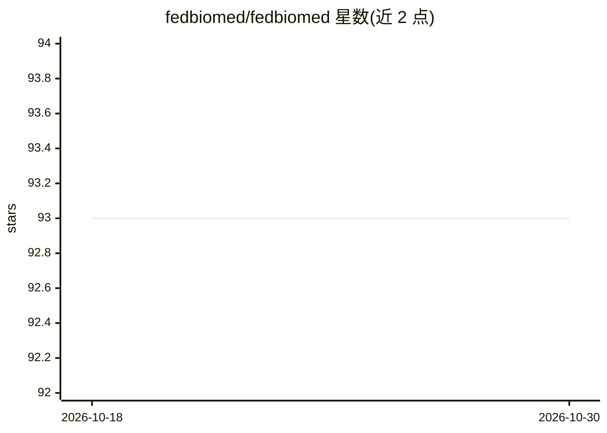

# fedbiomed/fedbiomed

⭐ 93 · Python · NOASSERTION · 推送 2026-10-29 · [GitHub](https://github.com/fedbiomed/fedbiomed) · [官网](https://fedbiomed.org) · 组织维护

**面向生物医学研究的联邦学习/联邦分析框架**

开源联邦学习框架，基于 Python、PyTorch 和 Scikit-learn，用于在医疗数据不集中的场景下开发和部署协作式机器学习分析（联邦学习与联邦分析）。采用 node/researcher 架构：节点管理本地数据集并参与训练，研究者端通过 Jupyter Notebook 或脚本发起训练（如 MNIST 上的联邦平均训练）。通过 pip 安装，支持 Linux/macOS 与 Windows WSL2，提供 CLI 和基于 Flask/ReactJS 的节点 GUI 管理数据集。

## 筛选速览

| 维度 | 判定 | 备注 |
|---|---|---|
| AI 角色 | `ai-ecosystem` | LLM/agent 周边工具 |
| 许可风险 | `none` | NOASSERTION |
| 部署形态 | `library` | 以包/库形式分发 |
| 模型依赖 | — | README 未给出锁定关系 |
| 硬件要求 | — | 无带数字的原话,不猜 |
| 安装摩擦 | `low` | 无编译、无系统依赖或容器化 |
| 成熟度 | — | 结构信号不足 |

## 能力要点

- 基于 PyTorch 与 Scikit-learn 的联邦学习/联邦分析框架
- node/researcher 架构，研究者端以 Jupyter Notebook 或脚本发起训练
- CLI 一条命令启动节点、上传数据集并配置 IP/组件目录
- Flask + ReactJS 节点 GUI，支持 HTTPS 与多节点 GUI 并行

## 适用场景

- 多家医院/机构在不共享原始数据的前提下联合训练模型
- 在分布式数据上开展协作式统计分析
- 研究者通过 Notebook 管理和运行联邦训练实验

## 场景标签

`模型训练` `数据分析` · 领域:效率与自动化

## 证据(README 行号)

> L15: Fed-BioMed is an open source project focused on empowering healthcare using non-centralized approaches for statisti
> L17: The project is currently based on Python, PyTorch and Scikit-learn, and enables developing and deploying collaborat

## 星数曲线

2026-10-18 93 → 2026-10-30 93（+0）

---
*卡片 v1 · prompt 1.4 · 生成 2026-10-23 · 置信度 high · 依据 README sha `5ae7d16dc37a` · [字段定义](../../DATASET.md)*
