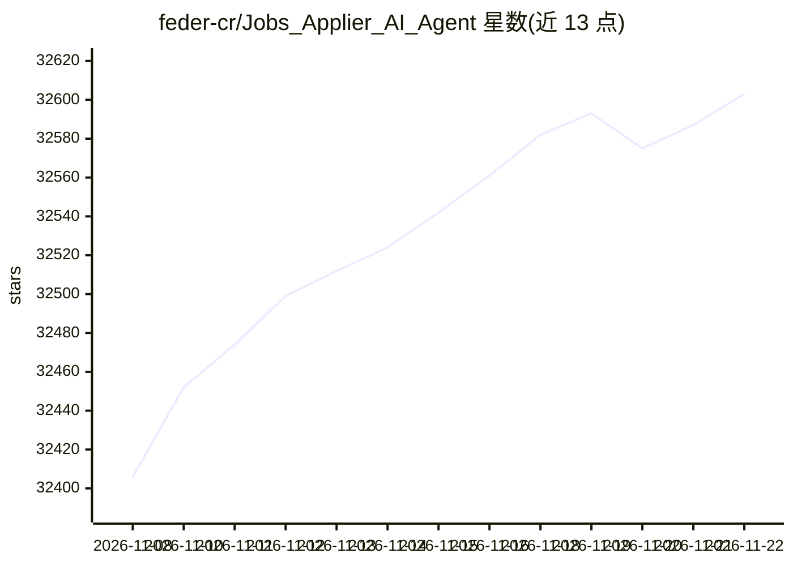

# feder-cr/Jobs_Applier_AI_Agent

⭐ 32,603 · Python · MIT · 推送 2026-11-21 · [GitHub](https://github.com/feder-cr/Jobs_Applier_AI_Agent) · 个人维护

**面向求职者的自动化职位搜索与自动投递机器人**

AIHawk 是一个求职自动化工具：读取用户简历生成搜索条件，在本机检索 37 个公开来源近 30 天的职位发布（每五小时重建），用 AI 对职位与简历的匹配度按 1-5 评分，用户挑选后由自动化 Firefox 浏览器填写公司站点的申请表、附上简历并提交，并记录每次申请的页面回复与截图。提供 Windows/Linux/macOS 脚本安装，首次启动下载约 250 MB；使用需 OrcaRouter API key 且需预充值，每次申请消耗少量费用；macOS 目前只能搜索评分，无法发送申请。

## 筛选速览

| 维度 | 判定 | 备注 |
|---|---|---|
| AI 角色 | `ai-native` | 本体是模型或模型工具 |
| 许可风险 | `permissive` | MIT |
| 部署形态 | `None` |  |
| 模型依赖 | — | README 未给出锁定关系 |
| 硬件要求 | — | 无带数字的原话,不猜 |
| 安装摩擦 | `low` | 无编译、无系统依赖或容器化 |
| 成熟度 | — | 结构信号不足 |

## 能力要点

- 读取简历生成搜索条件，本机检索 37 个公开来源职位
- AI 按简历匹配度对职位 1-5 评分
- Firefox 浏览器自动填写申请表、附简历并提交
- 记录每次申请的回复与截图

## 适用场景

- 批量筛选与简历匹配的职位并自动投递
- 跟踪每次申请的结果与页面截图
- 按简历生成职位搜索条件

## 场景标签

`浏览器自动化` · 领域:效率与自动化

## 证据(README 行号)

> L3:  An AI job application bot: automated job search, then it auto-applies to the jobs that match your resume, while you
> L24: |**2. Searches**|Millions of postings of the last 30 days from 37 public sources, rebuilt every five hours, searche
> L25: |**3. Scores**|Asks of every posting, against your resume, one question: is it in line with you? How sure the answe

## 星数曲线

2026-11-08 32,406 → 2026-11-22 32,603（+197）

---
*卡片 v1 · prompt 1.4 · 生成 2026-11-22 · 置信度 high · 依据 README sha `161ad4407e9a` · [字段定义](../../DATASET.md)*
