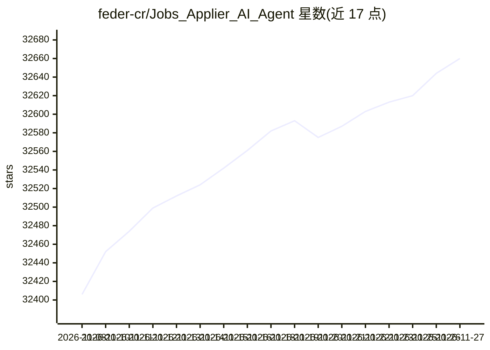

# feder-cr/Jobs_Applier_AI_Agent

⭐ 32,660 · Python · MIT · 推送 2026-11-24 · [GitHub](https://github.com/feder-cr/Jobs_Applier_AI_Agent) · 组织维护

**给求职者自动搜索职位并代填代投简历的 AI bot**

AIHawk 读取用户简历，将其转为搜索条件，在本机检索 37 个公开来源近 30 天的职位贴（每五小时重建）；对每条贴子按简历匹配度打 1-5 分，用户挑选后由 Firefox 浏览器打开公司官方申请表单，自动填写字段、附上简历并提交，并保存每次申请的页面答复与截图。依赖 OrcaRouter key 支付 AI 调用费用。Windows/Linux 有脚本安装，macOS 仅能搜索打分，尚不能发送申请；Linux 需桌面环境。

## 筛选速览

| 维度 | 判定 | 备注 |
|---|---|---|
| AI 角色 | `ai-native` | 本体是模型或模型工具 |
| 许可风险 | `permissive` | MIT |
| 部署形态 | `None` |  |
| 模型依赖 | — | README 未给出锁定关系 |
| 硬件要求 | — | 无带数字的原话,不猜 |
| 安装摩擦 | `low` | 无编译、无系统依赖或容器化 |
| 成熟度 | — | 结构信号不足 |

## 能力要点

- 37 个公开来源职位聚合，每五小时重建，本地检索
- 按简历匹配度对职位打 1-5 分
- Firefox 自动填写公司表单、附 CV 并提交
- 记录每次申请的页面答复与截图

## 适用场景

- 睡觉时自动批量投递匹配简历的职位
- 先按匹配度筛选职位再人工挑选后一键投递
- 留存每个申请的提交记录与页面回复截图

## 场景标签

`浏览器自动化` · 领域:效率与自动化

## 证据(README 行号)

> L3:  An AI job application bot: automated job search, then it auto-applies to the jobs that match your resume, while you
> L25: |**3. Scores**|Asks of every posting, against your resume, one question: is it in line with you? How sure the answe
> L27: |**5. Applies**|First a quick check that the posting is still open, on the sites where that can be told without a b

## 星数曲线

2026-11-08 32,406 → 2026-11-27 32,660（+254）

---
*卡片 v1 · prompt 1.4 · 生成 2026-11-23 · 置信度 high · 依据 README sha `75d0cc22d520` · [字段定义](../../DATASET.md)*
