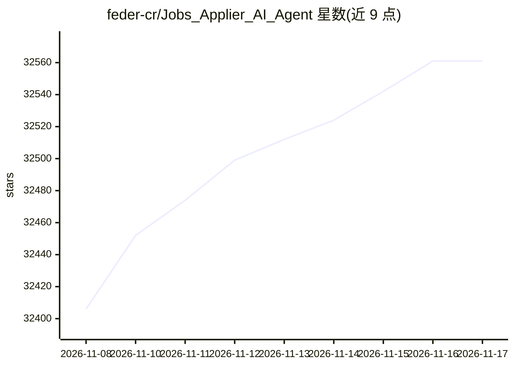

# feder-cr/Jobs_Applier_AI_Agent

⭐ 32,561 · Python · MIT · 推送 2026-11-16 · [GitHub](https://github.com/feder-cr/Jobs_Applier_AI_Agent) · 个人维护

**求职者的自动投递机器人：读简历、匹配职位并代填表投递**

面向求职者的自动化求职工具：读取用户简历并转化为职位搜索条件，从 37 个公共来源检索近 30 天的职位（每五小时重建索引），按简历匹配度给出 1-5 分评分；用户挑选后由 Firefox 自动打开公司官网申请表，填写必填字段、附上简历并提交，同时保存每页回执与截图。需要 OrcaRouter 的 API key（按次计费，每次申请花费数美分），macOS 下可搜索评分但暂不能发送申请。通过 PowerShell/shell 一键脚本安装，首启下载约 250 MB。

## 筛选速览

| 维度 | 判定 | 备注 |
|---|---|---|
| AI 角色 | `ai-native` | 本体是模型或模型工具 |
| 许可风险 | `permissive` | MIT |
| 部署形态 | `None` |  |
| 模型依赖 | — | README 未给出锁定关系 |
| 硬件要求 | — | 无带数字的原话,不猜 |
| 安装摩擦 | `low` | 无编译、无系统依赖或容器化 |
| 成熟度 | — | 结构信号不足 |

## 能力要点

- 读取简历自动生成搜索条件并按匹配度 1-5 分评分
- 37 个公共来源、近 30 天职位，索引每五小时重建
- Firefox 自动填写公司官网申请表并附简历提交
- 保存每次申请的页面回执与截图

## 适用场景

- 我想让程序自动筛出和简历匹配的职位再批量投递
- 我想在睡觉时自动完成简历投递
- 我想留档每次申请的结果页面以便跟进

## 场景标签

`浏览器自动化` · 领域:效率与自动化

## 证据(README 行号)

> L3:  An AI job application bot: automated job search, then it auto-applies to the jobs that match your resume, while you
> L22: |**3. Scores**|Asks of every posting, against your resume, one question: is it in line with you? How sure the answe
> L24: |**5. Applies**|First a quick check that the posting is still open, on the sites where that can be told without a b

## 星数曲线

2026-11-08 32,406 → 2026-11-17 32,561（+155）

---
*卡片 v1 · prompt 1.4 · 生成 2026-11-17 · 置信度 high · 依据 README sha `56843a5287a3` · [字段定义](../../DATASET.md)*
