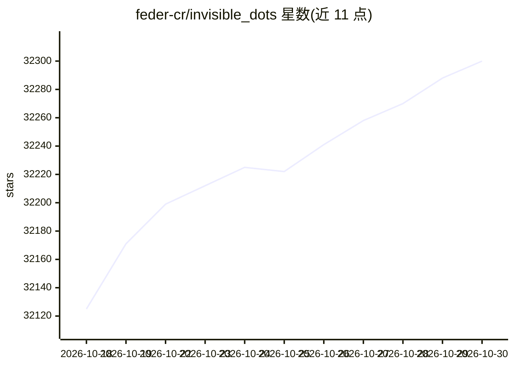

# feder-cr/invisible_dots

⭐ 32,300 · TypeScript · MIT · 推送 2026-10-25 · [GitHub](https://github.com/feder-cr/invisible_dots) · [官网](https://github.com/feder-cr/invisible_dots/blob/main/docs/guide.md) · 个人维护

**自托管的个人 AI 智能体：给每个用户一台带反检测浏览器的 VM**

以 Node.js CLI 与 Web 服务器形式提供的自托管平台：`setup --all` 通过 QEMU（KVM 或 Windows Hypervisor Platform 加速）构建/下载 Dot 的镜像，每个 Dot 拥有一台带持久磁盘的 Linux 桌面虚拟机，空闲休眠、有任务时唤醒。浏览器基于 C++ 补丁版 Firefox（invisible_playwright_mcp），指纹在引擎内设置，各身份独立保存 cookies 与登录态；支持 MCP 服务器接入、权限分级（allow/ask/deny）、定时任务队列、以及 Web UI/CLI/HTTP API/Telegram/WhatsApp 多通道触达，重启后消息与任务不丢失。README 注明状态为 alpha，仅支持 Linux 与 Windows，使用时需遵守目标站点条款与 robots.txt。

## 筛选速览

| 维度 | 判定 | 备注 |
|---|---|---|
| AI 角色 | `ai-native` | 本体是模型或模型工具 |
| 许可风险 | `permissive` | MIT |
| 部署形态 | `None` |  |
| 模型依赖 | locked-api |  |
| 硬件要求 | — | 无带数字的原话,不猜 |
| 安装摩擦 | `low` | 无编译、无系统依赖或容器化 |
| 成熟度 | `idea` | |

## 动量与使用信号

- 维护:`active` — 距上次 push 0.8 天,年发版 15,1 位贡献者
- 涨星:近 1 天 **+30**(自 20261016 起算)
- 下载:GitHub Release 附件 累计 1,060(17 个 release)
- 平台:WINDOWS / LINUX / WEB · 协议:MCP

## 能力要点

- 硬件加速 VM 内运行 Linux 桌面，持久磁盘，空闲休眠/按任务唤醒
- C++ 补丁版 Firefox 浏览器，指纹在引擎内设置，身份级 cookies 与登录态
- MCP 服务器声明式接入与 allow/ask/deny 权限分级，ask 请求可在重启后恢复
- Web UI、CLI、HTTP API、Telegram、WhatsApp 多通道接入

## 适用场景

- 让智能体每天定时查询机票价格并写入 CSV 汇报最低价
- 以指定身份登录网站下载发票并记住页面位置供下次使用
- 在自托管环境运行浏览器自动化任务，持久保存各身份登录态

## 场景标签

`浏览器自动化` `GUI 自动化` `AI 助手` · 领域:效率与自动化

## 证据(README 行号)

> L51: |**A computer of its own**|A hardware-accelerated VM with a Linux desktop and a persistent disk. It sleeps when idl
> L52: |**A browser that is not blocked**|invisible_playwright_mcp: Firefox patched in C++, the fingerprint set inside the
> L54: |**Your MCP servers**|Any MCP server you declare, a program on its computer or a URL, as in Claude Code. Its keys s

## 星数曲线

2026-10-18 32,125 → 2026-10-30 32,300（+175）

---
*卡片 v1 · prompt 1.4 · 生成 2026-10-18 · 置信度 high · 依据 README sha `5eba0cb44172` · [字段定义](../../DATASET.md)*
