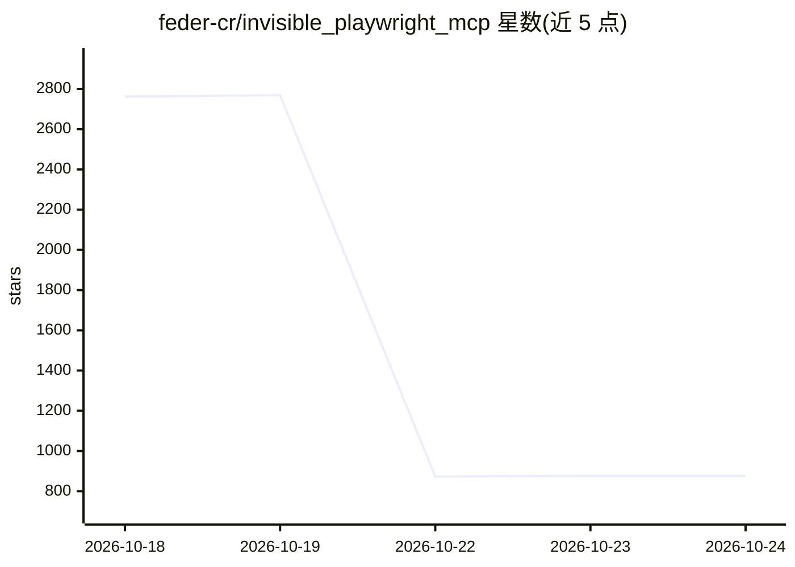

# feder-cr/invisible_playwright_mcp

⭐ 876 · Python · MIT · 推送 2026-10-21 · [GitHub](https://github.com/feder-cr/invisible_playwright_mcp) · [官网](https://github.com/feder-cr/invisible_playwright_mcp/wiki) · 个人维护

**绕过反爬检测的隐身浏览器自动化 MCP 服务器**

基于 stealth Firefox 的浏览器代理，以 MCP 服务器形式接入 Claude Code、Codex、Gemini CLI 等助手，或通过自带 Web UI 独立运行（经 OpenRouter 提供模型）。它以类人方式驱动页面（移动指针、按键），用于需要真实浏览器操作的场景如比价、填表、抓取。支持代理、固定种子指纹、持久化配置文件；引擎首次运行时从 GitHub release 下载。数据均存本地，无自有服务器。附 Python 库形式的引擎与核心模块。

## 筛选速览

| 维度 | 判定 | 备注 |
|---|---|---|
| AI 角色 | `ai-ecosystem` | LLM/agent 周边工具 |
| 许可风险 | `permissive` | MIT |
| 部署形态 | `None` |  |
| 模型依赖 | locked-api |  |
| 硬件要求 | — | 无带数字的原话,不猜 |
| 安装摩擦 | `low` | 无编译、无系统依赖或容器化 |
| 成熟度 | — | 结构信号不足 |

## 能力要点

- MCP 服务器接入 Claude Code/Codex/Gemini CLI，或 Web UI 独立运行
- stealth Firefox 反检测，指针与按键类人化驱动
- 代理、seed 指纹、profile 持久化等配置选项
- 本地运行，会话与截图仅存本机

## 适用场景

- 让 AI 助手代替我在有反爬/验证码的网站上执行操作
- 自动查机票最低价并逐日比较
- 需要登录态与真实浏览器交互的网页自动化任务

## 场景标签

`浏览器自动化` `网页抓取` · 领域:效率与自动化

## 证据(README 行号)

> L1: invisible_playwright_mcp, a browser agent anti-bots cannot see. An animation: asked in Claude Code for the cheapest 
> L8: ### 1. From your assistant, over MCP
> L131: The MCP server from option 1 ships inside this package: `invisible_playwright_mcp` with no

## 星数曲线

2026-10-18 2,762 → 2026-10-24 876（-1,886）

---
*卡片 v1 · prompt 1.4 · 生成 2026-10-21 · 置信度 high · 依据 README sha `071da649ee8a` · [字段定义](../../DATASET.md)*
