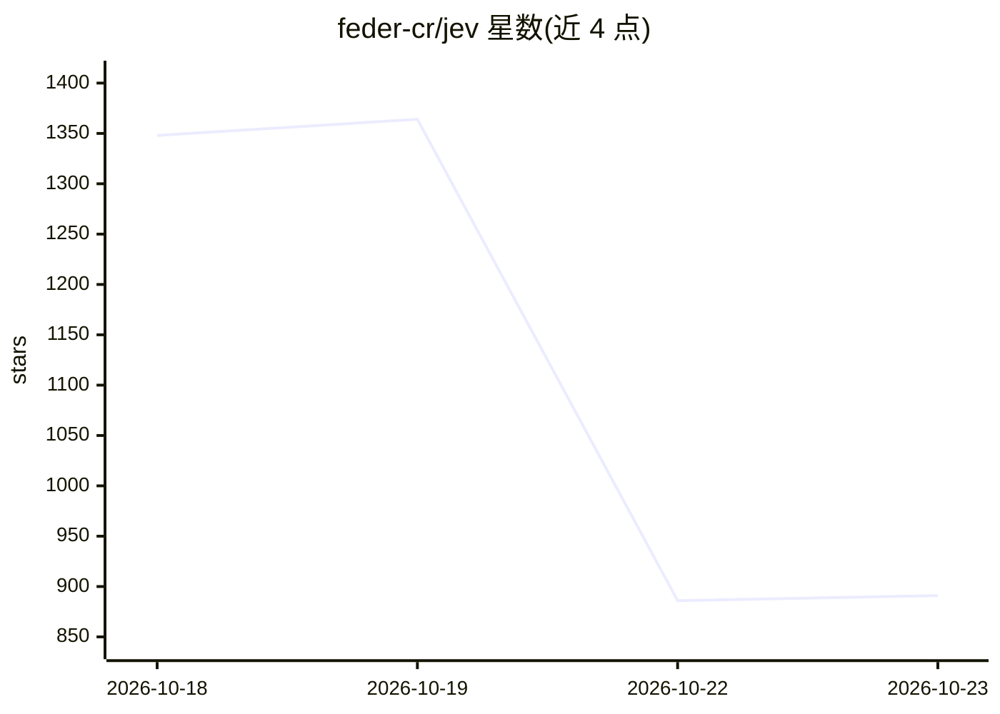

# feder-cr/jev

⭐ 891 · C++ · MIT · 推送 2026-10-18 · [GitHub](https://github.com/feder-cr/jev) · [官网](https://huggingface.co/feder-cr/jev) · 个人维护

**本地 CPU 运行的决策模型服务：文本+问题返回概率答案**

jevos 是一个以单一二进制在笔记本 CPU 上运行的决策推理服务：发送一段文本和问题（是/否、多选或评分），返回各答案的概率与置信度；置信度低时建议转人工。模型为 OpenVINO int8 格式（也提供 GGUF 供 llama.cpp 使用），API 兼容 Jev 的 TypeSafe 线格式，单请求可对同一文本提问多个问题。默认监听 127.0.0.1:8017，支持 Bearer 鉴权与无服务器的单文件决策模式；内存占用约 1 GB。自述定位为 Jev 与 Microsoft-Decision-1 的开源替代，README 基准中延迟低于但准确率多数低于 Jev。

## 筛选速览

| 维度 | 判定 | 备注 |
|---|---|---|
| AI 角色 | `ai-native` | 本体是模型或模型工具 |
| 许可风险 | `permissive` | MIT |
| 部署形态 | `desktop` | 安装包/桌面程序 |
| 模型依赖 | local-ok | 支持本地模型 |
| 硬件要求 | `cpu-ok` | |
| 安装摩擦 | `medium` | 含编译或系统依赖之一 |
| 成熟度 | `idea` | |

## 能力要点

- 单一二进制、纯 CPU 运行、无需 Python
- 是/否、多选、评分三类问题均返回概率与置信度
- API 兼容 Jev SDK 线格式，Jev 客户端代码可不改直接使用
- 模型同时提供 GGUF 格式供 llama.cpp 使用

## 适用场景

- 在本地对工单、申请等文本做是/否或多选分类决策
- 低置信度场景下先自动判定、再转人工处理
- 替换按 token 计费的云端决策 API 做本地零成本推理

## 场景标签

`推理引擎` · 领域:训练与推理

## 证据(README 行号)

> L3: **Decisions on a laptop CPU in 28–130 ms.** Send a text and a question (yes/no, multiple choice or a
> L4: score) and get back the probability of each answer, in TypeSafe Jev's API, on your own machine.
> L31: {"model": "jevos-v5", "answers": {"billing": {"type": "noul", "noul": 0.97}}, "usage": {"input_tokens": 28, "output

## 星数曲线

2026-10-18 1,348 → 2026-10-23 891（-457）

---
*卡片 v1 · prompt 1.4 · 生成 2026-10-21 · 置信度 mid · 依据 README sha `9d74f117f75b` · [字段定义](../../DATASET.md)*
