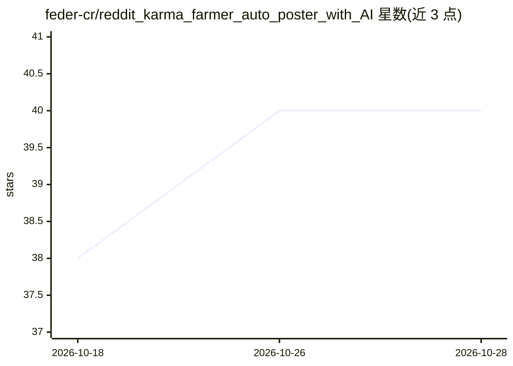

# feder-cr/reddit_karma_farmer_auto_poster_with_AI

⭐ 40 · Python · MIT · 推送 2026-08-18 · [GitHub](https://github.com/feder-cr/reddit_karma_farmer_auto_poster_with_AI) · 个人维护

**自动生成并发布 Reddit 帖子的 Python 脚本（GPT+LangChain）**

Python 脚本，用于自动在 Reddit 发帖：读取热门 subreddit 与热帖内容，按特定规则用 OpenAI GPT 模型与 LangChain 生成多种类型（clickbait、幽默、提问式等）的帖子并提交。包含发布失败、速率限制与版块限制的错误处理，并以随机间隔发布以规避自动化检测。需配置 Reddit API 凭据与 OpenAI API key；README 声明仅供教育演示用途，不建议实际使用，违规使用可能导致账号封禁。

## 筛选速览

| 维度 | 判定 | 备注 |
|---|---|---|
| AI 角色 | `ai-native` | 本体是模型或模型工具 |
| 许可风险 | `permissive` | MIT |
| 部署形态 | `library` | 以包/库形式分发 |
| 模型依赖 | — | README 未给出锁定关系 |
| 硬件要求 | — | 无带数字的原话,不猜 |
| 安装摩擦 | `low` | 无编译、无系统依赖或容器化 |
| 成熟度 | — | 结构信号不足 |

## 能力要点

- 分析热门 subreddit 与热帖后生成定制帖子
- 支持 clickbait/幽默/提问式等多种帖子类型
- 随机发布间隔与错误处理（失败、速率限制、版块限制）

## 适用场景

- 演示 AI 在社交媒体内容生成与自动交互上的能力
- 学习 Reddit API 与 GPT/LangChain 组合的自动化流程
- 了解自动发帖的实现方式及其平台规则风险

## 场景标签

`AI 写作` · 领域:内容生成

## 证据(README 行号)

> L27: The Reddit Post Generator is a Python script designed to automatically generate and post content on Reddit. By anal
> L31: - **Automatic Reddit Posting**: Posts are generated and submitted to trending subreddits.

## 星数曲线

2026-10-18 38 → 2026-10-28 40（+2）

---
*卡片 v1 · prompt 1.4 · 生成 2026-10-25 · 置信度 mid · 依据 README sha `1305477516a9` · [字段定义](../../DATASET.md)*
