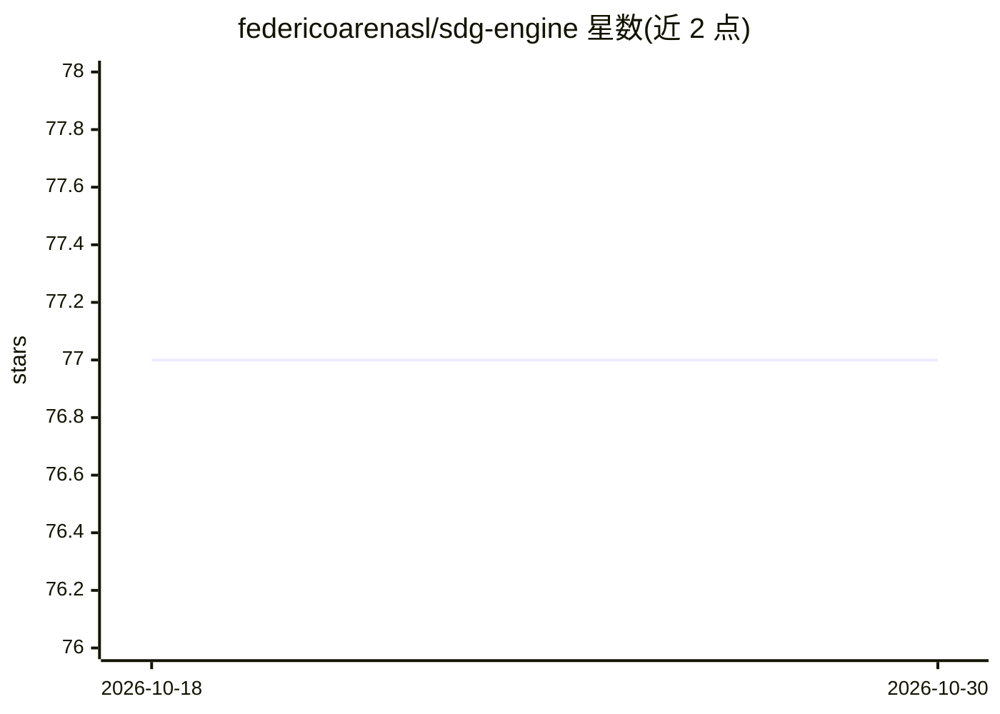

# federicoarenasl/sdg-engine

⭐ 77 · Jupyter Notebook · 推送 2025-12-26 · [GitHub](https://github.com/federicoarenasl/sdg-engine) · [官网](https://federicoarenas.io/projects/fine-tune-detr-1) · 个人维护

**基于 Blender 场景的计算机视觉合成数据生成引擎**

通过 Blender 渲染引擎从 3D 场景生成带标注的合成图像数据集：用户按约定搭建 .blend 场景并编写 YAML 配置，工具对场景做扫描式渲染，输出带边界框标注的图像，可按 train/validation/test 划分保存。数据集兼容 HuggingFace datasets，可用附带脚本推送到 Hub。附带复现 TYO-L 数据集的示例场景与两篇 DETR 微调教程。README 声明为进行中的工作，接口可能变化；当前仅支持 Blender。

## 筛选速览

| 维度 | 判定 | 备注 |
|---|---|---|
| AI 角色 | `ai-ecosystem` | LLM/agent 周边工具 |
| 许可风险 | `none` | — |
| 部署形态 | `None` |  |
| 模型依赖 | — | README 未给出锁定关系 |
| 硬件要求 | — | 无带数字的原话,不猜 |
| 安装摩擦 | `low` | 无编译、无系统依赖或容器化 |
| 成熟度 | `idea` | |

## 能力要点

- 从 Blender .blend 场景 + YAML 配置生成带边界框标注的图像数据集
- 输出数据集兼容 HuggingFace datasets，可推送至 Hub
- debug 模式输出标注叠加图与 GIF 动画可视化
- 附带复现 TYO-L 数据集的示例场景

## 适用场景

- 为物体检测模型生成合成训练数据
- 微调 DETR 等视觉模型时补充数据集
- 快速搭建可控场景批量产出带标注图像

## 场景标签

`目标检测` · 领域:感知与多模态

## 证据(README 行号)

> L4: A simple interface for synthetic data generation for computer vision using rendering engines.
> L6: By following some conventions (more below), you can basically set up any scene in Blender and `sdg-engine` will outp

## 星数曲线

2026-10-18 77 → 2026-10-30 77（+0）

---
*卡片 v1 · prompt 1.4 · 生成 2026-10-24 · 置信度 high · 依据 README sha `e22d9ef22f63` · [字段定义](../../DATASET.md)*
