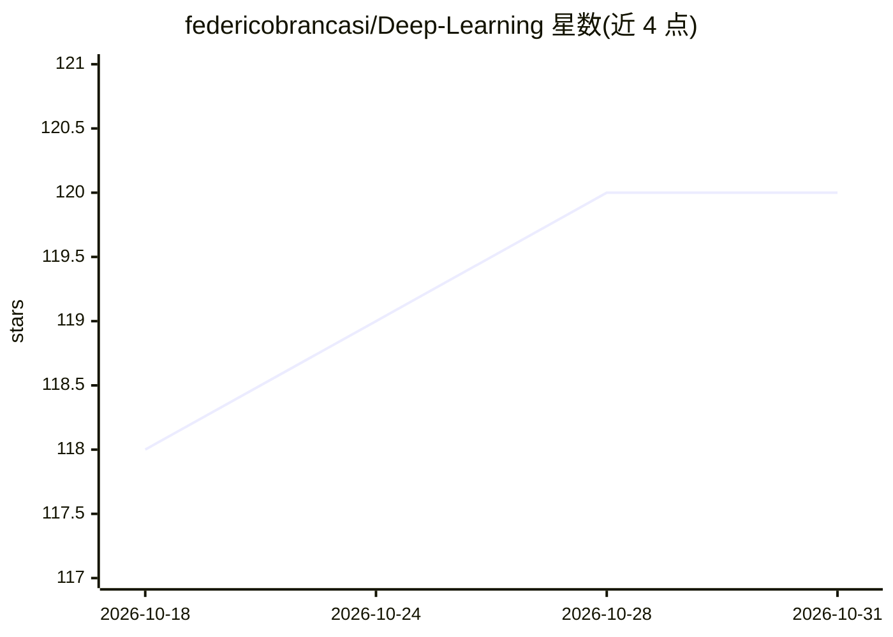

# federicobrancasi/Deep-Learning

⭐ 120 · TeX · AGPL-3.0 · 推送 2026-07-20 · [GitHub](https://github.com/federicobrancasi/Deep-Learning) · 个人维护

**面向学生与研究者的 LaTeX 深度学习教科书，附 TikZ 图源码**

由 Federico Brancasi 与 Jacopo Manenti 编写的深度学习书籍仓库，内容受特伦托大学 Elisa Ricci 教授课程启发，覆盖卷积网络、循环网络、Transformer、生成模型等主题，可整体下载。特色是全部插图用 LaTeX 的 TikZ 包绘制，各章节目录内提供插图源码，供读者查看、使用与改进。面向学生、研究者与 AI 爱好者，接受社区通过 fork 与 PR 贡献。仓库本身不含可运行代码，为阅读与参考资料。

## 筛选速览

| 维度 | 判定 | 备注 |
|---|---|---|
| AI 角色 | `ai-knowledge` | 知识聚合/清单类 |
| 许可风险 | `viral` | AGPL-3.0 |
| 部署形态 | `None` |  |
| 模型依赖 | — | README 未给出锁定关系 |
| 硬件要求 | — | 无带数字的原话,不猜 |
| 安装摩擦 | `low` | 无编译、无系统依赖或容器化 |
| 成熟度 | — | 结构信号不足 |

## 能力要点

- LaTeX 编写的深度学习书籍，提供完整下载
- 全书中插图均以 TikZ 绘制并公开源码
- 章节覆盖 CNN/RNN/Transformer/生成模型等主题
- 通过 fork 与 PR 接受社区贡献

## 适用场景

- 系统学习深度学习理论并参考可复用的图示
- 获取 TikZ 源码用于制作自己的神经网络可视化
- 课程学习或教学参考资料

## 场景标签

`教程课程` · 领域:学习与行业

## 证据(README 行号)

> L5: Welcome to the repository of our comprehensive Deep Learning book! This work is the culmination of our journey throu
> L6: Our goal is to bridge the gap between theoretical concepts and practical applications in the field of Deep Learning.
> L16: One of the unique features of this book is our extensive use of TikZ for creating high-quality illustrations. TikZ,

## 星数曲线

2026-10-18 118 → 2026-10-31 120（+2）

---
*卡片 v1 · prompt 1.4 · 生成 2026-10-23 · 置信度 high · 依据 README sha `4f64f35f3764` · [字段定义](../../DATASET.md)*
