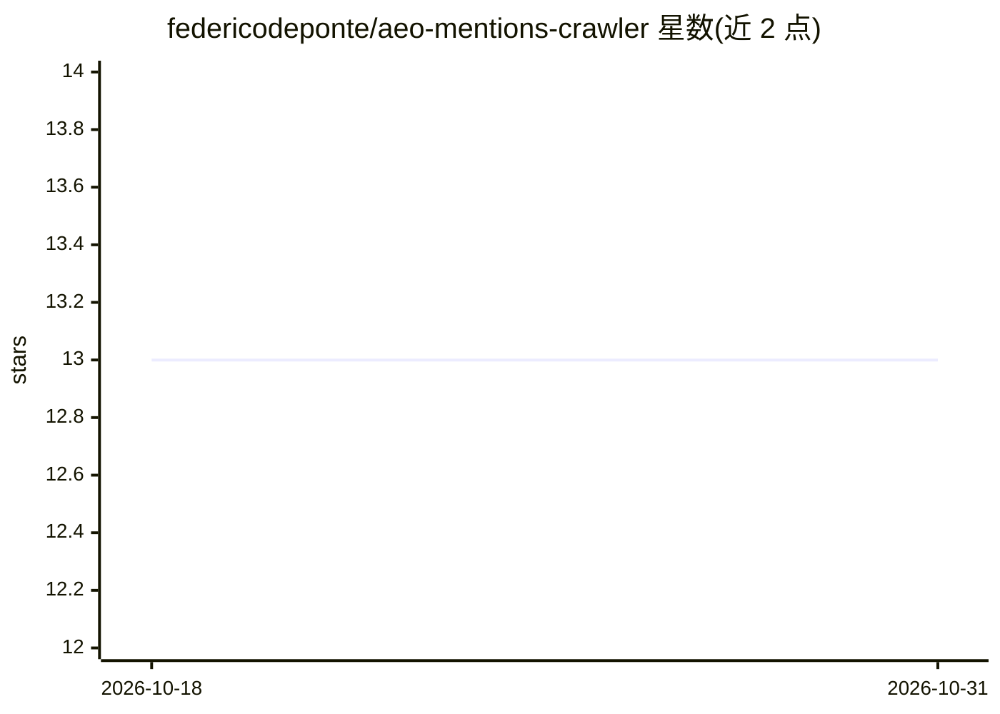

# federicodeponte/aeo-mentions-crawler

⭐ 13 · TypeScript · 推送 2026-03-18 · [GitHub](https://github.com/federicodeponte/aeo-mentions-crawler) · 组织维护

**面向 AI 搜索引擎的内容生成平台：分析网站并产出 AEO 关键词与博客**

基于 Next.js 14 + TypeScript 的独立 AEO 内容生成工具：用 Gemini 3.0 Pro Preview（集成 Google 搜索与 URL 上下文提取）分析公司网站，抽取痛点、价值主张与用例；再生成带 AEO 评分（类型/意图/引用潜力/竞争度）的关键词，经 Modal 托管的 OpenBlog 12 阶段流水线批量生成分批内链、引用校验的博客。支持 28+ 语言、50+ 国家、6 种语气，数据存于浏览器 localStorage，需自备 Gemini API key。面向营销/SEO 从业者。

## 筛选速览

| 维度 | 判定 | 备注 |
|---|---|---|
| AI 角色 | `ai-native` | 本体是模型或模型工具 |
| 许可风险 | `permissive` | — |
| 部署形态 | `None` |  |
| 模型依赖 | — | README 未给出锁定关系 |
| 硬件要求 | — | 无带数字的原话,不猜 |
| 安装摩擦 | `low` | 无编译、无系统依赖或容器化 |
| 成熟度 | — | 结构信号不足 |

## 能力要点

- Gemini 3.0 Pro Preview 网站分析：痛点/价值主张/用例自动抽取
- AEO 关键词评分（类型/意图/引用潜力/竞争度），CSV 批量上传（最多 50 条）
- OpenBlog 12 阶段流水线批量生成博客，含内链与引用校验
- 28+ 语言、50+ 国家、6 种语气；数据存浏览器 localStorage 无外部数据库

## 适用场景

- 为企业网站生成面向 ChatGPT/Perplexity 等 AI 搜索的优化内容
- 批量做 AEO 关键词研究并导出 CSV
- 批量生成带内链与引用的博客并导出 Markdown

## 场景标签

`AI 写作` · 领域:内容生成

## 证据(README 行号)

> L3: **Standalone AEO content generation platform** - Generate keywords and blogs optimized for AI search engines (ChatGP
> L24: ### ✍️ **Blog Generation (OpenBlog Engine)**
> L144: - **AI**: Gemini 3.0 Pro Preview (native tools)

## 星数曲线

2026-10-18 13 → 2026-10-31 13（+0）

---
*卡片 v1 · prompt 1.4 · 生成 2026-10-31 · 置信度 high · 依据 README sha `50404f3f1251` · [字段定义](../../DATASET.md)*
