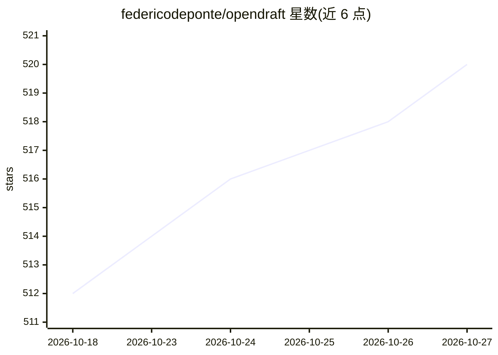

# federicodeponte/opendraft

⭐ 520 · Python · MIT · 推送 2026-10-16 · [GitHub](https://github.com/federicodeponte/opendraft) · [官网](https://openpaper.dev/) · 个人维护

**开源 Python 引擎：生成带 DOI 多库核验引文的研究论文草稿**

面向研究者、研究生与开发者的命令行工具和 Python 库：输入一个主题，由 19 个分工 AI agent（检索、结构、写作、引文、润色、导出）生成 1-2 万字以上的学术草稿或文献综述。核心机制是引文核验：默认仅保留 DOI 被 CrossRef、OpenAlex、Semantic Scholar 中至少两个数据库收录的来源，逐条记录核验状态；另有 claim 级相关性判定（RELEVANT/IRRELEVANT/UNCERTAIN，语言模型判断而非证明）。支持导出 PDF/DOCX/LaTeX，57+ 种语言，需自备模型 API key；明确声明不用于一键成稿或替代人类研究者。也可作为技能用于 Claude Code/Codex 等 agent。

## 筛选速览

| 维度 | 判定 | 备注 |
|---|---|---|
| AI 角色 | `ai-native` | 本体是模型或模型工具 |
| 许可风险 | `permissive` | MIT |
| 部署形态 | `library` | 以包/库形式分发 |
| 模型依赖 | — | README 未给出锁定关系 |
| 硬件要求 | — | 无带数字的原话,不猜 |
| 安装摩擦 | `low` | 无编译、无系统依赖或容器化 |
| 成熟度 | — | 结构信号不足 |

## 能力要点

- 19 个分工 agent 的研究-写作-引文-导出流水线
- 默认 DOI 需在 CrossRef/OpenAlex/Semantic Scholar 至少两库确认，未确认即丢弃并记录
- claim 级引文相关性判定（含置信度阈值与移除策略）
- 导出 PDF / DOCX / LaTeX，支持 57+ 种语言

## 适用场景

- 我要为文献综述或学位论文生成带核验引文的结构化初稿
- 我想检查 AI 草稿中的引用 DOI 是否真实存在
- 作为研究者我想审计和扩展现有的研究 agent 流水线

## 场景标签

`多智能体` `AI 写作` `科研工具` · 领域:Agent 开发

## 证据(README 行号)

> L45: |**What it is**|Open-source Python engine for AI-generated research drafts with citations checked against CrossRef,
> L60: **OpenDraft is an open-source Python engine that generates source-grounded research drafts using 19 specialized AI 
> L64: - **OpenDraft is** a command-line tool and Python library for drafting academic papers.

## 星数曲线

2026-10-18 512 → 2026-10-27 520（+8）

---
*卡片 v1 · prompt 1.4 · 生成 2026-10-22 · 置信度 mid · 依据 README sha `af30a355e2aa` · [字段定义](../../DATASET.md)*
