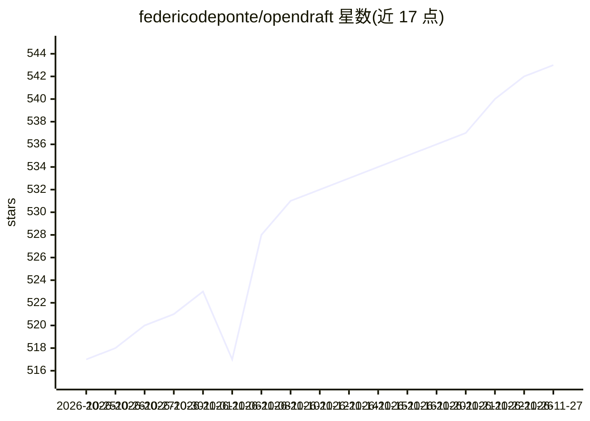

# federicodeponte/opendraft

⭐ 543 · Python · MIT · 推送 2026-11-04 · [GitHub](https://github.com/federicodeponte/opendraft) · [官网](https://opendraft.xyz) · 个人维护

**研究者用：多 agent 生成带 DOI 核验引用的论文草稿**

从单一主题生成研究论文、文献综述与论文章节的 agent 系统，19 个 agent 按研究、结构、撰写、验证、精炼、增强六个阶段工作。引用核验机制：来源需至少在 Crossref、OpenAlex、Semantic Scholar 中的两个平台持有 DOI 才保留，并有二次检查判断来源与声明的匹配度。默认使用 Gemini API key，可选 Claude 或 OpenAI；输出可导出 PDF、Word 和 LaTeX。README 明确说明草稿是起点，使用前需人工审阅。

## 筛选速览

| 维度 | 判定 | 备注 |
|---|---|---|
| AI 角色 | `ai-native` | 本体是模型或模型工具 |
| 许可风险 | `permissive` | MIT |
| 部署形态 | `library` | 以包/库形式分发 |
| 模型依赖 | — | README 未给出锁定关系 |
| 硬件要求 | — | 无带数字的原话,不猜 |
| 安装摩擦 | `low` | 无编译、无系统依赖或容器化 |
| 成熟度 | — | 结构信号不足 |

## 能力要点

- 19 个 agent 分六阶段（研究/结构/撰写/验证/精炼/增强）协作
- 引用需至少在 Crossref、OpenAlex、Semantic Scholar 两个平台核验 DOI
- 支持 bachelor/master/phd 等级别与多语言草稿生成
- 可作为 skill 在 Claude Code、Codex 等 agent 中使用

## 适用场景

- 从主题生成带 DOI 核验引用的论文初稿
- 修订已有草稿的指定部分
- 对任意论文 PDF 生成 5 条要点摘要

## 场景标签

`多智能体` `科研工具` `AI 写作` · 领域:Agent 开发

## 证据(README 行号)

> L3: **The open-source agent system that writes research papers with verified citations.**
> L74: 19 agents work in six phases: research, structure, compose, validate, refine, enhance. A source stays only if at le

## 星数曲线

2026-10-25 517 → 2026-11-27 543（+26）

---
*卡片 v1 · prompt 1.4 · 生成 2026-11-25 · 置信度 high · 依据 README sha `1de43218a31f` · [字段定义](../../DATASET.md)*
