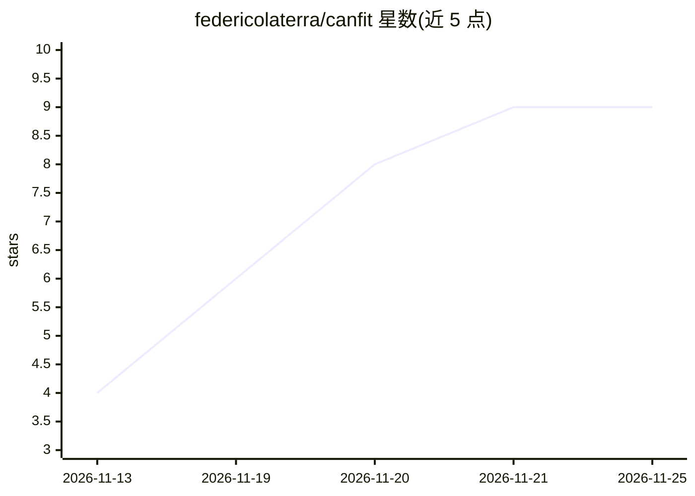

# federicolaterra/canfit

⭐ 9 · Rust · MIT · 推送 2026-11-11 · [GitHub](https://github.com/federicolaterra/canfit) · 个人维护

**本地 LLM 用户的 top 命令：判断模型和应用能否在当前内存中运行**

跨平台终端系统监控工具，除显示 RAM、CPU 与内存压力外，读取 GGUF 文件估算权重、上下文缓存与开销，判断模型当前能否启动；也可根据配置声明、历史测量或内置目录判断 Docker Desktop、虚拟机、IDE 等应用的内存可行性。提供 watch 子命令测量命令的真实峰值内存、按可回收内存与安全性排序的关闭建议、统一压力等级与本地压力事件历史。单二进制分发，无运行时依赖，无遥测，MIT 许可。

## 筛选速览

| 维度 | 判定 | 备注 |
|---|---|---|
| AI 角色 | `ai-enhanced` | 去掉 AI 部分产品仍成立 |
| 许可风险 | `permissive` | MIT |
| 部署形态 | `desktop` | 安装包/桌面程序 |
| 模型依赖 | local-ok | 支持本地模型 |
| 硬件要求 | — | 无带数字的原话,不猜 |
| 安装摩擦 | `low` | 无编译、无系统依赖或容器化 |
| 成熟度 | — | 结构信号不足 |

## 能力要点

- 读取 GGUF 文件并对比当前可用内存判断模型能否启动（exit 0/1/2）
- watch 子命令测量任意命令及其进程树的真实峰值内存
- 按可回收内存与安全性排序的关闭建议，确认后一键关闭
- Apple Silicon 上结合 GPU wired limit 判断，不支持 NVIDIA/AMD VRAM

## 适用场景

- 启动本地模型前确认内存是否够用
- 排查哪个进程占用内存并决定安全关闭哪个
- 测量某条命令运行时的真实内存峰值

## 场景标签

 · 领域:开发者工具/系统监控

## 证据(README 行号)

> L3:  The top command for people running local LLMs and apps
> L24: canfit is a cross-platform system monitor that, besides showing RAM, CPU and pressure, answers:
> L26: - **Can this model fit right now?** It reads the GGUF file, estimates weights + context cache +

## 星数曲线

2026-11-13 4 → 2026-11-25 9（+5）

---
*卡片 v1 · prompt 1.4 · 生成 2026-11-20 · 置信度 high · 依据 README sha `1490cfac6098` · [字段定义](../../DATASET.md)*
