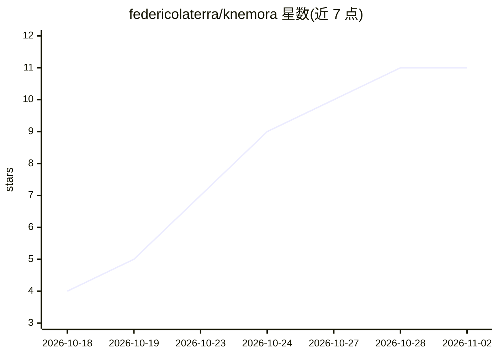

# federicolaterra/knemora

⭐ 11 · Python · MIT · 推送 2026-10-27 · [GitHub](https://github.com/federicolaterra/knemora) · [官网](https://knemora.space) · 个人维护

**本地优先的 AI（SI）第二大脑：知识图谱+Wiki+本地推理**

开源本地优先知识与 agent 平台：摄入 PDF/TXT/Markdown/DOCX/CSV/XLSX 文档，编译为带 claim 级溯源的可移植 Markdown Wiki，用 Sigma.js/Graphology 渲染原生 Second Brain 图谱，搜索采用 BM25 与有界图导航、不强制 embedding。AI 推理通过本地 llama.cpp 运行默认 Qwen3-8B（GGUF），Google ADK 提供 agent 编排，无强制云服务或外部 LLM API。面向自托管个人用户；当前为 v0.1.0-alpha 早期测试阶段，托管安装路径支持 macOS Apple Silicon（Node.js 24 必需，磁盘至少 7 GB），未声明跨平台。

## 筛选速览

| 维度 | 判定 | 备注 |
|---|---|---|
| AI 角色 | `ai-native` | 本体是模型或模型工具 |
| 许可风险 | `permissive` | MIT |
| 部署形态 | `None` |  |
| 模型依赖 | local-ok | 支持本地模型 |
| 硬件要求 | — | 无带数字的原话,不猜 |
| 安装摩擦 | `low` | 无编译、无系统依赖或容器化 |
| 成熟度 | `idea` | |

## 能力要点

- 文档摄入→Markdown Wiki 编译，含不可变源存储与 claim 级溯源
- Sigma.js/Graphology 原生 Second Brain 全局/局部图视图
- 本地 llama.cpp 推理，默认 Qwen3-8B GGUF，支持导入 Hugging Face GGUF
- 备份/恢复/迁移工作流，无商业版、无遥测

## 适用场景

- 在本地搭建带知识图谱和溯源的私人知识库
- 把 PDF/DOCX 等文档整理成可检索、可问答的 Wiki
- 在无云端依赖的设备上运行本地 LLM 知识问答

## 场景标签

`知识库管理` `知识图谱` `文档问答` · 领域:知识与检索

## 证据(README 行号)

> L27: Knemora is an open-source, local-first knowledge and agent platform with a native Second Brain
> L28: graph, a portable Markdown Wiki, and local AI (SI) inference. It works without a mandatory cloud
> L51: - local Qwen inference through llama.cpp behind a provider-neutral boundary;

## 星数曲线

2026-10-18 4 → 2026-11-02 11（+7）

---
*卡片 v1 · prompt 1.4 · 生成 2026-11-02 · 置信度 high · 依据 README sha `76a29c2cd2ed` · [字段定义](../../DATASET.md)*
