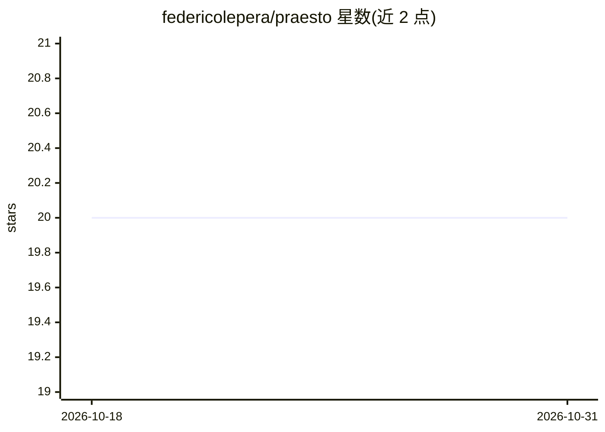

# federicolepera/praesto

⭐ 20 · Go · Apache-2.0 · 推送 2026-07-05 · [GitHub](https://github.com/federicolepera/praesto) · 个人维护

**Kubernetes operator：为工作负载预缓存并挂载 AI 模型工件**

由 CRD ModelCache 驱动的 Kubernetes 原生模型缓存方案，含 operator、node-agent 与 CSI 驱动。通过声明式资源在选定节点预下载 Hugging Face 模型工件到节点本地存储，CSI 驱动以只读卷挂载进 Pod；也支持共享 RWX PVC + downloader Job 模式。基于 admission webhook（mutating/validating）按命名空间 opt-in 注入模型卷并校验资源。本地 CSI 模式当前仅支持公开 Hugging Face 下载，私有模型 token 支持仅在 PVC 模式可用。以 Helm chart 安装。

## 筛选速览

| 维度 | 判定 | 备注 |
|---|---|---|
| AI 角色 | `ai-ecosystem` | LLM/agent 周边工具 |
| 许可风险 | `permissive` | Apache-2.0 |
| 部署形态 | `library` | 以包/库形式分发 |
| 模型依赖 | — | README 未给出锁定关系 |
| 硬件要求 | — | 无带数字的原话,不猜 |
| 安装摩擦 | `low` | 无编译、无系统依赖或容器化 |
| 成熟度 | `idea` | |

## 能力要点

- ModelCache CRD 声明模型，本地 CSI 或共享 PVC 两种存储模式
- node-agent 下载到节点本地存储，CSI 以只读卷挂载，缓存完成标记防止部分下载可见
- mutating webhook 按命名空间 opt-in 自动注入模型卷，validating webhook 校验 ModelCache
- 未使用 TTL 的本地缓存可被驱逐，Pod 到达时按需重新水化

## 适用场景

- 避免集群中各工作负载重复下载同一模型文件
- 让推理服务以本地路径直接读取已就绪模型卷
- 在偏好 RWX 存储的集群用 PVC + downloader Job 分发模型

## 场景标签

`推理引擎` · 领域:训练与推理

## 证据(README 行号)

> L9:  Kubernetes-native model cache operator, node-agent, and CSI driver for mounting AI model artifacts into workloads.
> L33: Praesto helps Kubernetes workloads use AI and LLM model artifacts without downloading the same files again and agai
> L35: You declare which model you need with a `ModelCache`. Praesto prepares that cache on the selected Kubernetes nodes,

## 星数曲线

2026-10-18 20 → 2026-10-31 20（+0）

---
*卡片 v1 · prompt 1.4 · 生成 2026-10-28 · 置信度 high · 依据 README sha `b12f70b54059` · [字段定义](../../DATASET.md)*
