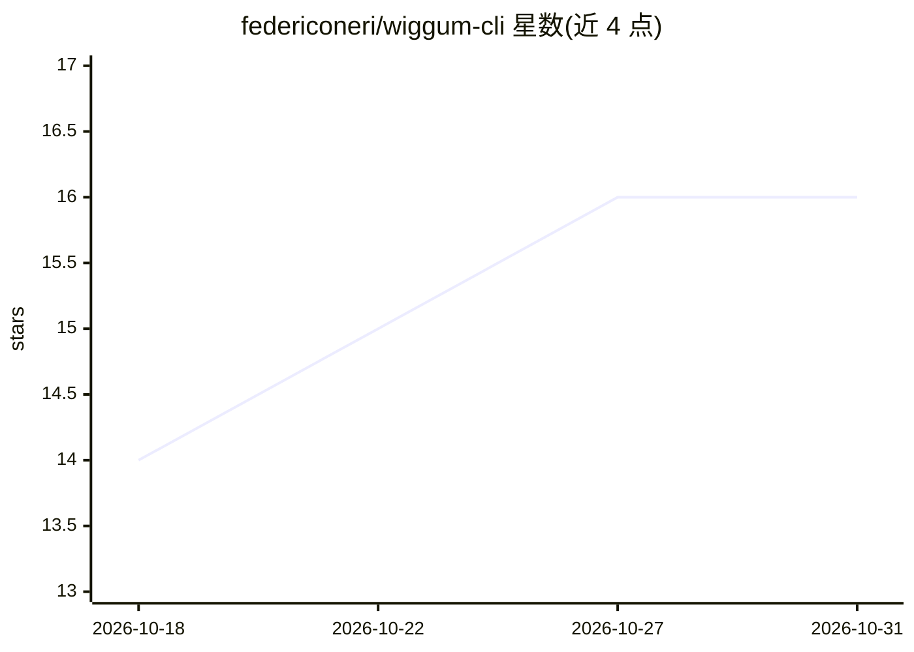

# federiconeri/wiggum-cli

⭐ 16 · TypeScript · NOASSERTION · 推送 2026-06-22 · [GitHub](https://github.com/federiconeri/wiggum-cli) · [官网](https://wiggum.app) · 个人维护

**给开发者的 AI agent CLI：扫描代码库生成规格并驱动自主编码循环**

面向开发者的 npm 全局命令行工具，接入任意代码库后分两阶段工作：先由自身作为 agent 扫描项目、检测 80+ 技术栈、通过 4 阶段 AI 访谈生成特性规格；再把编码循环委托给 Claude Code 或 Codex CLI，运行 implement→test→fix 循环直至完成，支持 git worktree 隔离并行。另含 Backlog Agent（按优先级处理 GitHub issues）、TUI 交互模式与 Action Inbox 人工审批机制。BYOK 模式，密钥存本地。需 Node.js≥18、Git、GitHub CLI 及 Anthropic/OpenAI/OpenRouter API key。许可为 MIT + Commons Clause，禁止销售本软件或基于其功能的服务。

## 筛选速览

| 维度 | 判定 | 备注 |
|---|---|---|
| AI 角色 | `ai-ecosystem` | LLM/agent 周边工具 |
| 许可风险 | `none` | NOASSERTION |
| 部署形态 | `library` | 以包/库形式分发 |
| 模型依赖 | locked-api |  |
| 硬件要求 | — | 无带数字的原话,不猜 |
| 安装摩擦 | `low` | 无编译、无系统依赖或容器化 |
| 成熟度 | — | 结构信号不足 |

## 能力要点

- AI 访谈生成项目定制化特性规格（4 阶段）
- 委托 Claude Code / Codex CLI 运行 implement→test→fix 自主循环
- Backlog Agent 按依赖调度自动处理 GitHub issues
- 自动检测 80+ 技术栈（框架/数据库/ORM/部署目标/MCP）

## 适用场景

- 在现有代码库上以规格驱动方式开发新特性
- 自动循环执行实现-测试-修复直到测试通过
- 按优先级批量处理 GitHub backlog issues

## 场景标签

`编码 Agent` · 领域:编码与开发

## 证据(README 行号)

> L23: Wiggum is an **AI agent CLI** that plugs into any codebase and prepares it for autonomous feature development.
> L25: It works in two phases. First, **Wiggum itself is the agent**: it scans your project, detects your stack, and runs 
> L118: Wiggum hands the spec + prompts + project context to Claude Code or Codex CLI and runs an autonomous loop:

## 星数曲线

2026-10-18 14 → 2026-10-31 16（+2）

---
*卡片 v1 · prompt 1.4 · 生成 2026-10-30 · 置信度 high · 依据 README sha `6a68559d60d1` · [字段定义](../../DATASET.md)*
