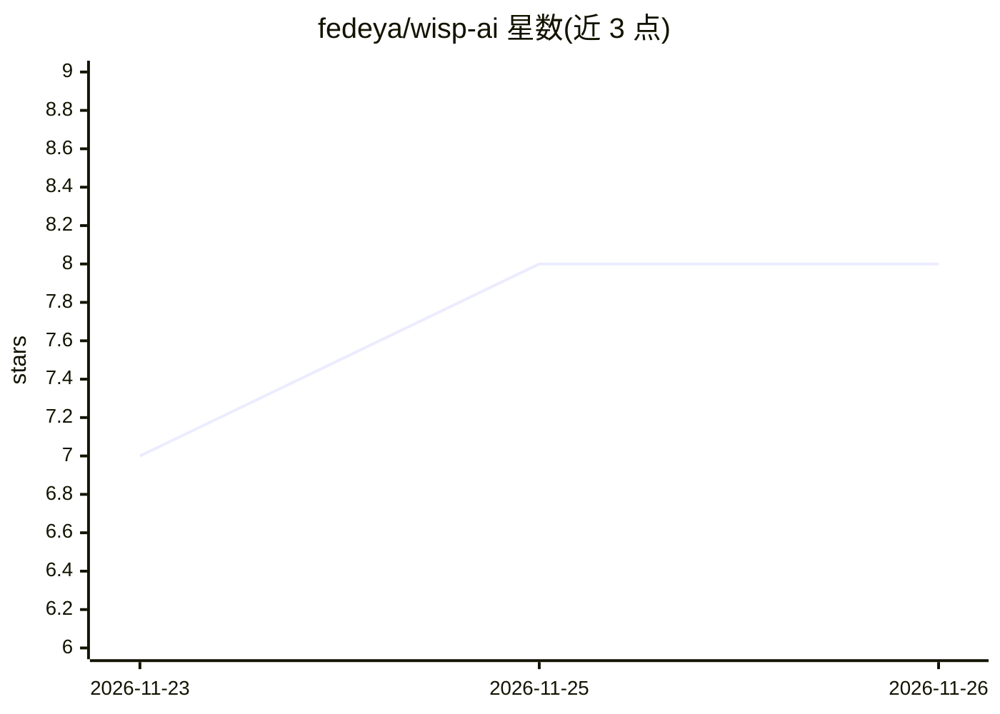

# fedeya/wisp-ai

⭐ 8 · TypeScript · GPL-3.0 · 推送 2026-11-25 · [GitHub](https://github.com/fedeya/wisp-ai) · [官网](https://wisp.fedeya.sh) · 个人维护

**魔兽世界游戏内 AI 助手：不离开游戏即可查询角色信息**

由 Lua 插件与 Windows 桌面应用组成的魔兽世界（Forever 版）助手：插件读取任务、天赋、法术、装备与背包数据，通过游戏内 `/wisp` 对话或悬停绑定键向所选 AI 提供商提问，支持物品属性对比、NPC 目的地查找、参考资料查询与角色进度追踪。用户在桌面应用中自行接入 ChatGPT、Claude、Gemini 或兼容网关并选择默认模型；桌面应用需保持运行，插件通过 addon 文件与游戏通信，大回复可能耗时数秒。

## 筛选速览

| 维度 | 判定 | 备注 |
|---|---|---|
| AI 角色 | `ai-native` | 本体是模型或模型工具 |
| 许可风险 | `viral` | GPL-3.0 |
| 部署形态 | `desktop` | 安装包/桌面程序 |
| 模型依赖 | — | README 未给出锁定关系 |
| 硬件要求 | — | 无带数字的原话,不猜 |
| 安装摩擦 | `low` | 无编译、无系统依赖或容器化 |
| 成熟度 | — | 结构信号不足 |

## 能力要点

- 游戏内 /wisp 对话与悬停物品/法术/单位查询
- 支持接入 ChatGPT、Claude、Gemini、网关及兼容端点，自选默认模型
- 实时读取任务、天赋、法术、装备与背包数据，支持属性对比与进度追踪
- 提供 Windows x64 安装包，插件同时发布于 CurseForge

## 适用场景

- 游戏内直接询问当前任务哪些可以就近完成
- 对比背包里装备与身上装备的属性
- 设置掉落物品或金币的收集进度追踪
- 查找最近的 NPC（如法师训练师）位置

## 场景标签

`AI 助手` · 领域:对话与助手

## 证据(README 行号)

> L5: Ask about your character without leaving the game. Wisp brings your chosen AI provider into World of Warcraft: Forev
> L27: 2. In **AI Providers**, choose **Add provider** to find **ChatGPT**, **Claude**, **Gemini**, gateways and compatibl

## 星数曲线

2026-11-23 7 → 2026-11-26 8（+1）

---
*卡片 v1 · prompt 1.4 · 生成 2026-11-23 · 置信度 high · 依据 README sha `0effdc7f61a7` · [字段定义](../../DATASET.md)*
