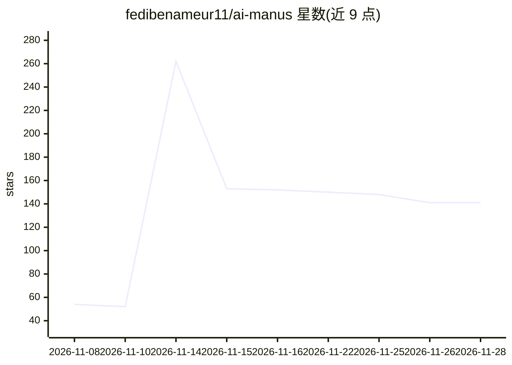

# fedibenameur11/ai-manus

⭐ 141 · Python · Apache-2.0 · 推送 2026-11-19 · [GitHub](https://github.com/fedibenameur11/ai-manus) · 个人维护

**通用自主 AI Agent：代用户执行代码与浏览器操作完成任务**

面向个人与轻量工作场景的自主 AI Agent 系统：以执行代码和控制浏览器为核心机制，将用户的自然语言指令分解为多步骤动作——写脚本并运行、打开网页、操作页面元素、跨多页收集信息、填写表单等。定位为家庭、学习与轻办公的助手，可在会话间保持任务模式的一致性；README 未给出具体安装命令，仅提到下载入口与最低配置要求。

## 筛选速览

| 维度 | 判定 | 备注 |
|---|---|---|
| AI 角色 | `ai-native` | 本体是模型或模型工具 |
| 许可风险 | `permissive` | Apache-2.0 |
| 部署形态 | `None` |  |
| 模型依赖 | — | README 未给出锁定关系 |
| 硬件要求 | — | 无带数字的原话,不猜 |
| 安装摩擦 | `low` | 无编译、无系统依赖或容器化 |
| 成熟度 | — | 结构信号不足 |

## 能力要点

- 自主代码执行：运行脚本完成多步骤任务
- 浏览器控制：导航网页、填写表单、采集信息
- 会话间保持任务模式，无需重复解释工作流

## 适用场景

- 整理研究资料并运行小脚本计算
- 从多个网页收集数据并汇总成小报告
- 把重复性的网页检查、文件整理交给 Agent 处理

## 场景标签

`聊天机器人` `浏览器自动化` `编码 Agent` · 领域:效率与自动化

## 证据(README 行号)

> L10: - **Autonomous Code Execution:** Manus AI agent runs code on its own to complete tasks, so you can focus on decisio
> L18: Manus is an autonomous AI agent designed to run code and control a browser on your behalf. Instead of acting like a

## 星数曲线

2026-11-08 54 → 2026-11-28 141（+87）

---
*卡片 v1 · prompt 1.4 · 生成 2026-11-27 · 置信度 high · 依据 README sha `b891e4f171c5` · [字段定义](../../DATASET.md)*
