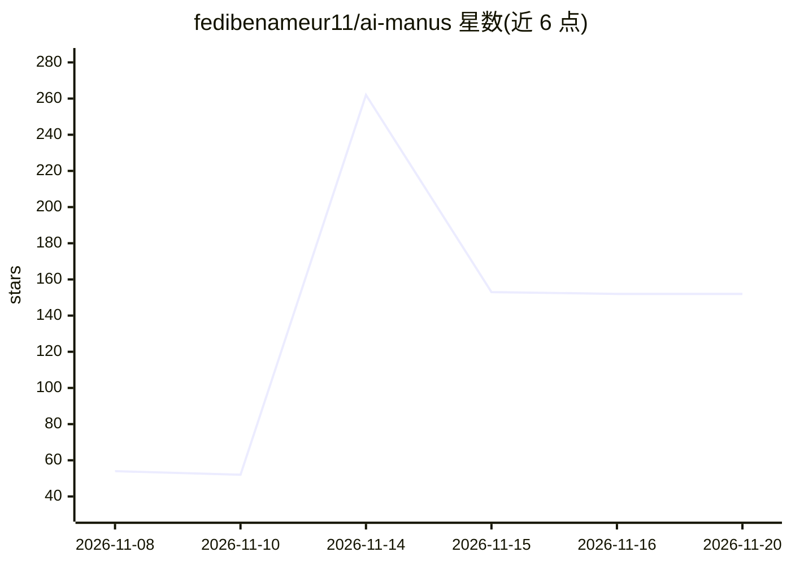

# fedibenameur11/ai-manus

⭐ 152 · Python · Apache-2.0 · 推送 2026-11-19 · [GitHub](https://github.com/fedibenameur11/ai-manus) · 个人维护

**通用自主 AI Agent：代用户执行代码与浏览器操作**

描述为一个通用自主 AI Agent 系统：可自主运行代码、控制浏览器（导航网页、填写表单、采集信息），将多步指令拆解执行，定位为面向个人日常任务的个人助理，覆盖学习、居家项目与轻量办公场景。README 以功能介绍、兼容性最低配置（64 位系统、双核 CPU、4 GB RAM）和使用步骤为主；未给出具体安装命令、下载链接或技术架构说明，仅出现 Download 字样与推广码。

## 筛选速览

| 维度 | 判定 | 备注 |
|---|---|---|
| AI 角色 | `ai-native` | 本体是模型或模型工具 |
| 许可风险 | `permissive` | Apache-2.0 |
| 部署形态 | `None` |  |
| 模型依赖 | — | README 未给出锁定关系 |
| 硬件要求 | — | 无带数字的原话,不猜 |
| 安装摩擦 | `low` | 无编译、无系统依赖或容器化 |
| 成熟度 | — | 结构信号不足 |

## 能力要点

- 自主代码执行：代理可自行运行脚本完成任务
- 浏览器控制：导航网页、填表、采集信息
- 跨会话记忆：记住既有工作流程并复用
- 多模态 Agent 系统，支持沙箱环境运行工具

## 适用场景

- 帮我自动收集多个网页的资料并整理笔记
- 让代理代我填写重复性表单
- 安排学习和居家项目中的琐碎任务
- 快速跑小脚本实验而不搭完整环境

## 场景标签

`AI 助手` `浏览器自动化` `编码 Agent` · 领域:效率与自动化

## 证据(README 行号)

> L18: Manus is an autonomous AI agent designed to run code and control a browser on your behalf. Instead of acting like a
> L41: |**Memory (RAM)**|4 GB|8 GB or more for heavy Manus autonomous tasks|

## 星数曲线

2026-11-08 54 → 2026-11-20 152（+98）

---
*卡片 v1 · prompt 1.4 · 生成 2026-11-19 · 置信度 low · 依据 README sha `a860df1fb938` · [字段定义](../../DATASET.md)*
