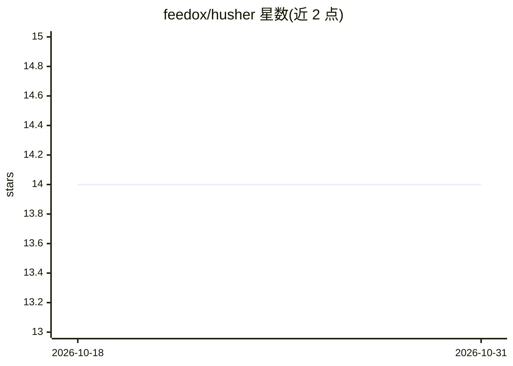

# feedox/husher

⭐ 14 · TypeScript · MIT · 推送 2026-09-19 · [GitHub](https://github.com/feedox/husher) · [官网](https://lab.feedox.com/wild-llama/husher) · 个人维护

**文本隐藏编码库：用零宽字符把文本藏于人眼、对 LLM 可读**

提供 hush/dehush/sanitize 三种操作：将输入字符串编码为零宽字符等不可见字符构成的隐藏文本，可逆向解码还原，也可清除文本中的隐藏字符。隐藏字符类型为携带自定义载荷的旗帜 emoji 变体，支持 utf-8 等多语言字符集的解码。面向研究 LLM 对不可见字符解释行为的开发者与安全研究人员，以 npm 包和 npx 命令行提供，另有客户端在线演示工具。

## 筛选速览

| 维度 | 判定 | 备注 |
|---|---|---|
| AI 角色 | `ai-enhanced` | 去掉 AI 部分产品仍成立 |
| 许可风险 | `permissive` | MIT |
| 部署形态 | `library` | 以包/库形式分发 |
| 模型依赖 | — | README 未给出锁定关系 |
| 硬件要求 | — | 无带数字的原话,不猜 |
| 安装摩擦 | `low` | 无编译、无系统依赖或容器化 |
| 成熟度 | — | 结构信号不足 |

## 能力要点

- hush：将任意字符串编码为零宽字符隐藏文本
- dehush：逆向解码还原隐藏文本（含旗帜 emoji 载荷）
- sanitize：清除文本中的隐藏字符
- 支持 utf-8 等多语言字符集

## 适用场景

- 构造对人类不可见但 LLM 可读取的提示载荷，测试模型行为
- 检测并清除文本中潜藏的不可见指令
- 研究基于不可见 unicode 字符的 LLM 安全问题

## 场景标签

`网络安全` · 领域:学习与行业

## 证据(README 行号)

> L3: A library to analyze text that contains special unicode characters that are unnoticeable by naked eye but are interp
> L7: 1. ⭐️ hush - encode input string into hidden text with zero-width characters
> L10: 4. Support dehush of flag emojis, utf-8 and other multilingual charsets, while the hidden characters are type of fl

## 星数曲线

2026-10-18 14 → 2026-10-31 14（+0）

---
*卡片 v1 · prompt 1.4 · 生成 2026-10-31 · 置信度 mid · 依据 README sha `1a2fad77f7a1` · [字段定义](../../DATASET.md)*
