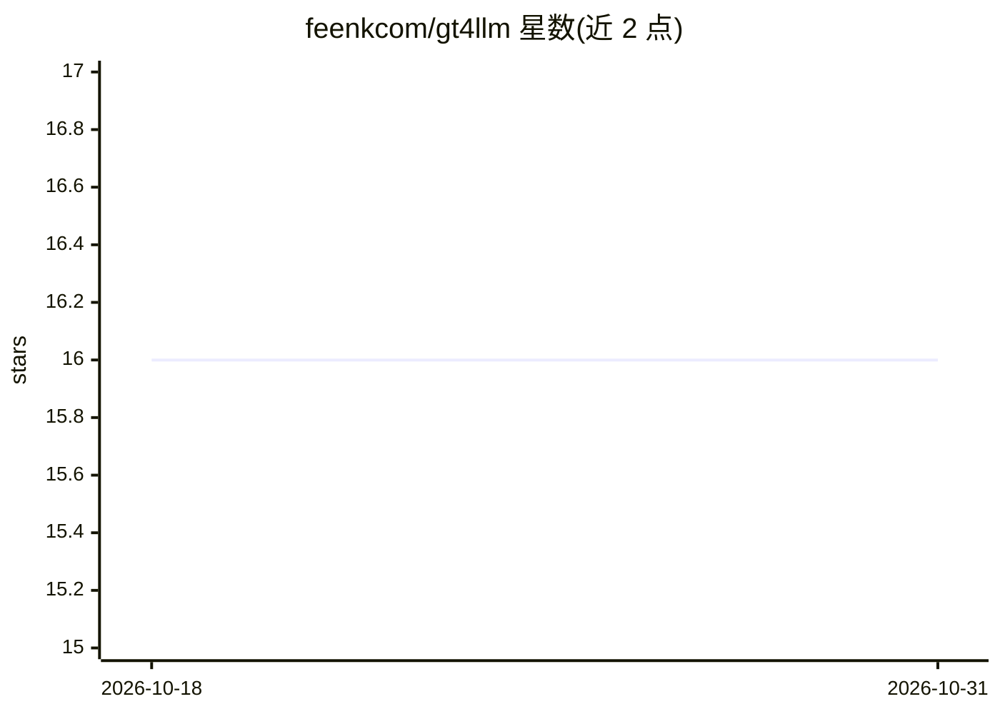

# feenkcom/gt4llm

⭐ 16 · Smalltalk · MIT · 推送 2026-10-30 · [GitHub](https://github.com/feenkcom/gt4llm) · 组织维护

**Pharo/Glamorous Toolkit 环境下调用 LLM 的客户端库**

面向 Glamorous Toolkit 与 GemStone 的 LLM 工具库，提供 OpenAI、Ollama、Anthropic 三家 API 的客户端，以及通用 LLM 工具函数和在用户界面中集成 LLM 的示例。通过 Pharo Metacello 代码片段在 Glamorous Toolkit image 内安装，GemStone 侧则借助 scripts 目录脚本配合 gt4gemstone 完成。默认已包含在常规 Glamorous Toolkit 构建中。

## 筛选速览

| 维度 | 判定 | 备注 |
|---|---|---|
| AI 角色 | `ai-ecosystem` | LLM/agent 周边工具 |
| 许可风险 | `permissive` | MIT |
| 部署形态 | `None` |  |
| 模型依赖 | local-ok | 支持本地模型 |
| 硬件要求 | — | 无带数字的原话,不猜 |
| 安装摩擦 | `low` | 无编译、无系统依赖或容器化 |
| 成熟度 | — | 结构信号不足 |

## 能力要点

- 提供 OpenAI、Ollama、Anthropic 三种 LLM 客户端
- 包含在用户界面中集成 LLM 的示例
- Metacello 方式在 Glamorous Toolkit/GemStone 中安装

## 适用场景

- 在 Glamorous Toolkit 内直接调用 OpenAI/Ollama/Anthropic 模型
- 在 Pharo 应用界面中嵌入 LLM 交互
- 基于 GemStone 环境接入 LLM

## 场景标签

`模型网关` · 领域:Agent 开发

## 证据(README 行号)

> L3: is a library for working with LLMs, designed for use with Glamorous Toolkit and GemStone.
> L5: Currently it includes:

## 星数曲线

2026-10-18 16 → 2026-10-31 16（+0）

---
*卡片 v1 · prompt 1.4 · 生成 2026-10-30 · 置信度 high · 依据 README sha `2d4dee6f0da9` · [字段定义](../../DATASET.md)*
