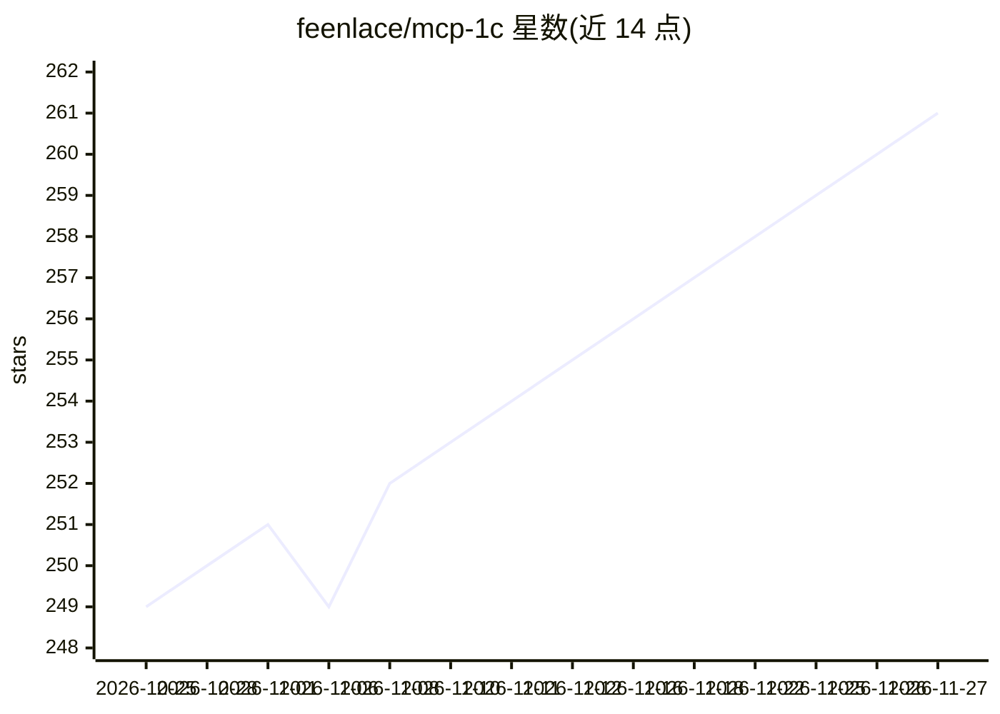

# feenlace/mcp-1c

⭐ 261 · Go · MIT · 推送 2026-11-25 · [GitHub](https://github.com/feenlace/mcp-1c) · [官网](https://feenlace.ru) · 个人维护

**让 AI 助手读取 1С 配置并生成 BSL 代码的 MCP 服务器**

用 Go 编写的 MCP 服务器，单个二进制文件、无外部运行时依赖，通过 19 个工具将 AI 助手接入 1С:Enterprise 数据库：读取元数据树、对象结构、执行 SELECT 查询、读取事件日志、内置 BSL 语法帮助（180 个函数），并支持 BM25/regex/exact 三模式的代码全文检索（需 --dump 启用）。通过 --install 自动向 1С 基座安装扩展，要求平台版本 ≥8.3.10，HTTP 服务需经 Apache/IIS 发布。可与任何 MCP 兼容客户端配合。

## 筛选速览

| 维度 | 判定 | 备注 |
|---|---|---|
| AI 角色 | `ai-ecosystem` | LLM/agent 周边工具 |
| 许可风险 | `permissive` | MIT |
| 部署形态 | `desktop` | 安装包/桌面程序 |
| 模型依赖 | local-ok | 支持本地模型 |
| 硬件要求 | — | 无带数字的原话,不猜 |
| 安装摩擦 | `low` | 无编译、无系统依赖或容器化 |
| 成熟度 | — | 结构信号不足 |

## 能力要点

- 单二进制零依赖，Go 实现，无需 Python/Node.js/JVM/EDT
- 19 个工具覆盖元数据、数据查询、代码搜索与事件日志
- 分片并行索引：13,000+ 模块约 7 秒，磁盘缓存二次启动即时
- 支持本地模型运行，数据不出内网

## 适用场景

- 让 AI 助手基于真实 1С 配置生成准确的 BSL 代码
- 在内网用本地模型查询 1С 元数据与数据
- 对 1С 模块代码做全文检索与子系统分析

## 场景标签

`代码生成` `AI 助手` · 领域:编码与开发

## 证据(README 行号)

> L5:  MCP-сервер для интеграции AI-ассистентов с 1С:Предприятие
> L10: AI видит метаданные вашей конфигурации 1С и генерирует точный код на BSL. Работает с любым MCP-совместимым клиентом
> L14: MCP-1C не привязан к конкретной нейросети. Работает с любым MCP-совместимым клиентом:

## 星数曲线

2026-10-25 249 → 2026-11-27 261（+12）

---
*卡片 v1 · prompt 1.4 · 生成 2026-11-25 · 置信度 high · 依据 README sha `6b62d7d9a1ef` · [字段定义](../../DATASET.md)*
