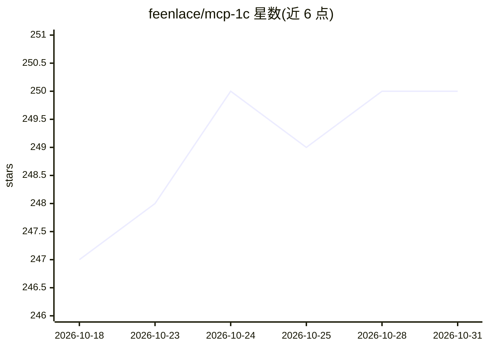

# feenlace/mcp-1c

⭐ 250 · Go · MIT · 推送 2026-10-20 · [GitHub](https://github.com/feenlace/mcp-1c) · [官网](https://feenlace.ru) · 个人维护 · 中文 README

**连接 AI 助手与 1С:Enterprise 的 MCP 服务器，读取配置元数据**

用 Go 编写的单一二进制 MCP 服务器，让任意 MCP 兼容客户端（Claude、Cursor、Ollama 等本地模型）访问 1С 配置元数据、代码全文检索（BM25/regex/exact、俄英 BSL 同义词）、执行查询（仅 SELECT）、读取事件日志等 19 个工具。通过 HTTP 服务与 1С 库通信，支持自动安装扩展（--install）。除 MIT 开源版外提供付费订阅版本（扩展版/专业版），专业版含全库批量分析、语义搜索、CI/CD 集成等。

## 筛选速览

| 维度 | 判定 | 备注 |
|---|---|---|
| AI 角色 | `ai-ecosystem` | LLM/agent 周边工具 |
| 许可风险 | `permissive` | MIT |
| 部署形态 | `desktop` | 安装包/桌面程序 |
| 模型依赖 | local-ok | 支持本地模型 |
| 硬件要求 | — | 无带数字的原话,不猜 |
| 安装摩擦 | `low` | 无编译、无系统依赖或容器化 |
| 成熟度 | `idea` | |

## 能力要点

- 单一 Go 二进制、零运行时依赖，提供 19 个工具
- 代码全文检索：BM25 智能模式 + regex/exact，内置 BSL 俄英同义词
- 分片并行索引（约 7 秒索引 13,000+ 模块），磁盘缓存支持二次启动即时可用
- 与模型无关：本地模型（Ollama/LM Studio/llama.cpp）或云服务均可

## 适用场景

- 1С 开发者用 AI 助手基于真实配置元数据生成 BSL 代码
- 对 1С 代码库做全文检索和查询执行
- 通过 MCP 客户端审查 1С 事件日志与存储结构

## 场景标签

`代码生成` · 领域:编码与开发

## 证据(README 行号)

> L5:  MCP-сервер для интеграции AI-ассистентов с 1С:Предприятие
> L10: AI видит метаданные вашей конфигурации 1С и генерирует точный код на BSL. Работает с любым MCP-совместимым клиентом
> L14: MCP-1C не привязан к конкретной нейросети. Работает с любым MCP-совместимым клиентом:

## 星数曲线

2026-10-18 247 → 2026-10-31 250（+3）

---
*卡片 v1 · prompt 1.4 · 生成 2026-10-22 · 置信度 high · 依据 README sha `d037a52fb387` · [字段定义](../../DATASET.md)*
