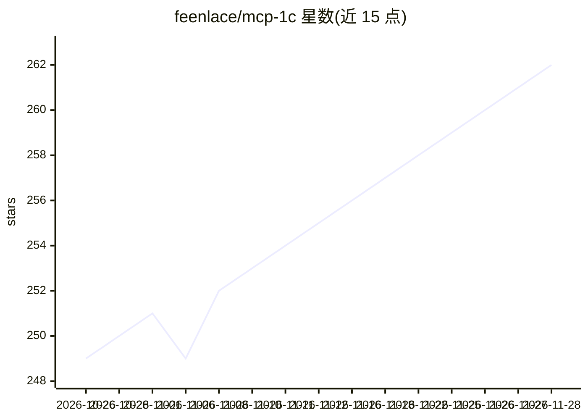

# feenlace/mcp-1c

⭐ 262 · Go · MIT · 推送 2026-11-25 · [GitHub](https://github.com/feenlace/mcp-1c) · [官网](https://feenlace.ru) · 个人维护

**将 AI 助手接入 1С:Enterprise 数据库并生成 BSL 代码的 MCP 服务器**

以 Go 编写的 MCP 服务器，编译为单个二进制文件、无运行时依赖，通过 1С 的 HTTP 服务读取配置元数据与数据。提供 19 个工具：元数据树、对象/表单结构、代码全文检索（BM25/regex/exact，含 BSL 俄英同义词）、查询执行与校验、事件日志读取等。配合任意 MCP 兼容客户端使用，支持本地模型（Ollama/LM Studio/llama.cpp）与云端服务；需在 1С 中安装配套扩展并发布 HTTP 服务（Apache/IIS）。

## 筛选速览

| 维度 | 判定 | 备注 |
|---|---|---|
| AI 角色 | `ai-ecosystem` | LLM/agent 周边工具 |
| 许可风险 | `permissive` | MIT |
| 部署形态 | `desktop` | 安装包/桌面程序 |
| 模型依赖 | local-ok | 支持本地模型 |
| 硬件要求 | — | 无带数字的原话,不猜 |
| 安装摩擦 | `low` | 无编译、无系统依赖或容器化 |
| 成熟度 | — | 结构信号不足 |

## 能力要点

- 单二进制零依赖（Go 编写），无需 Python/Node.js/JVM/EDT
- 19 个工具：元数据读取、代码搜索（BM25/regex/exact）、SELECT 查询、事件日志
- 分片并行索引，13,000+ 模块约 7 秒，磁盘缓存二次启动即时
- 自动安装模式 --install 自动定位平台、部署扩展并更新数据库配置

## 适用场景

- 让 AI 客户端读取真实 1С 配置结构后生成 BSL 代码
- 在本地网络内用 Ollama 等本地模型分析 1С 数据，数据不出网
- 在无代码索引的情况下检索和定位模块代码
- 审计配置的子系统分布与事件日志

## 场景标签

`代码生成` · 领域:编码与开发

## 证据(README 行号)

> L5:  MCP-сервер для интеграции AI-ассистентов с 1С:Предприятие
> L14: MCP-1C не привязан к конкретной нейросети. Работает с любым MCP-совместимым клиентом:
> L26: - **Один бинарник, ноль зависимостей.** Написан на Go - не нужен Python, Node.js, JVM или EDT. Скачал, запустил, ра

## 星数曲线

2026-10-26 249 → 2026-11-28 262（+13）

---
*卡片 v1 · prompt 1.4 · 生成 2026-11-27 · 置信度 high · 依据 README sha `89a24a212099` · [字段定义](../../DATASET.md)*
