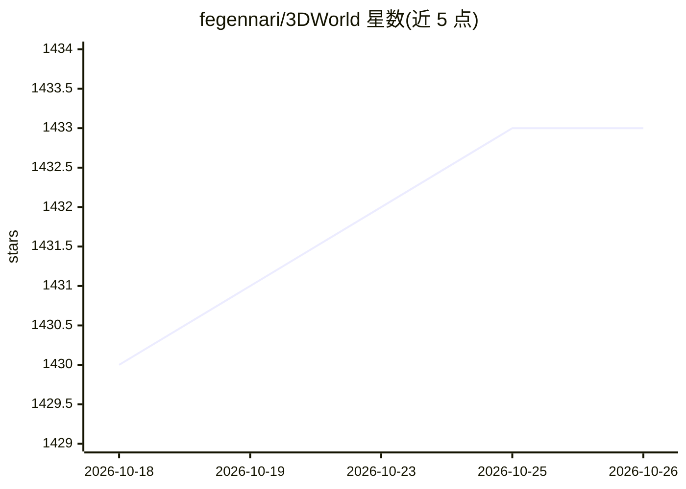

# fegennari/3DWorld

⭐ 1,433 · C++ · GPL-3.0 · 推送 2026-10-25 · [GitHub](https://github.com/fegennari/3DWorld) · 个人维护

**个人开发的跨平台 OpenGL 程序化 3D 游戏引擎，供图形学与游戏开发参考**

C++/GLSL 编写的跨平台 OpenGL 3D 游戏引擎，自 2001 年起个人开发。功能覆盖地形/植被/城市/建筑内外部的程序化生成、程序化宇宙生成、可实时编辑的体素地形、物理模拟（>1 万动态物体）、日夜循环与天气、PBR 材质、骨骼动画，以及 NPC 的寻路与行为 AI。内置多个游戏模式（FPS、飞船殖民、僵尸模式）。以源码形式提供，附 Visual Studio 工程与 Linux makefile（实验性），大型模型文件需另行下载。作者声明以教育目的在 GPLv3 下发布，不作为商业工具。

## 筛选速览

| 维度 | 判定 | 备注 |
|---|---|---|
| AI 角色 | `ai-enhanced` | 去掉 AI 部分产品仍成立 |
| 许可风险 | `dual` | GPL-3.0 |
| 部署形态 | `None` |  |
| 模型依赖 | — | README 未给出锁定关系 |
| 硬件要求 | `gpu-8g` | |
| 安装摩擦 | `medium` | 含编译或系统依赖之一 |
| 成熟度 | — | 结构信号不足 |

## 能力要点

- 地形/城市/建筑内外部/宇宙的程序化内容生成
- 物理模拟支持超过 1 万个动态物体
- NPC（行人/车辆/动物）的寻路与目标选择 AI 行为
- 优化用于加载与实时渲染大模型（>1GB 顶点/纹理数据）

## 适用场景

- 学习程序化生成与实时渲染的图形学实现
- 探索程序化城市、建筑内部与地形生成算法
- 在生成的 3D 世界中体验内置 FPS/宇宙殖民/僵尸玩法模式

## 场景标签

 · 领域:游戏引擎/计算机图形学

## 证据(README 行号)

> L7: 3DWorld is a cross-platform OpenGL-based 3D Game Engine that I've been working on since I took the CS184 computer gr
> L16: * NPC AI behaviors for people, cars, and animals with target selection and path finding/navigation

## 星数曲线

2026-10-18 1,430 → 2026-10-26 1,433（+3）

---
*卡片 v1 · prompt 1.4 · 生成 2026-10-21 · 置信度 mid · 依据 README sha `ecb36eebdac1` · [字段定义](../../DATASET.md)*
