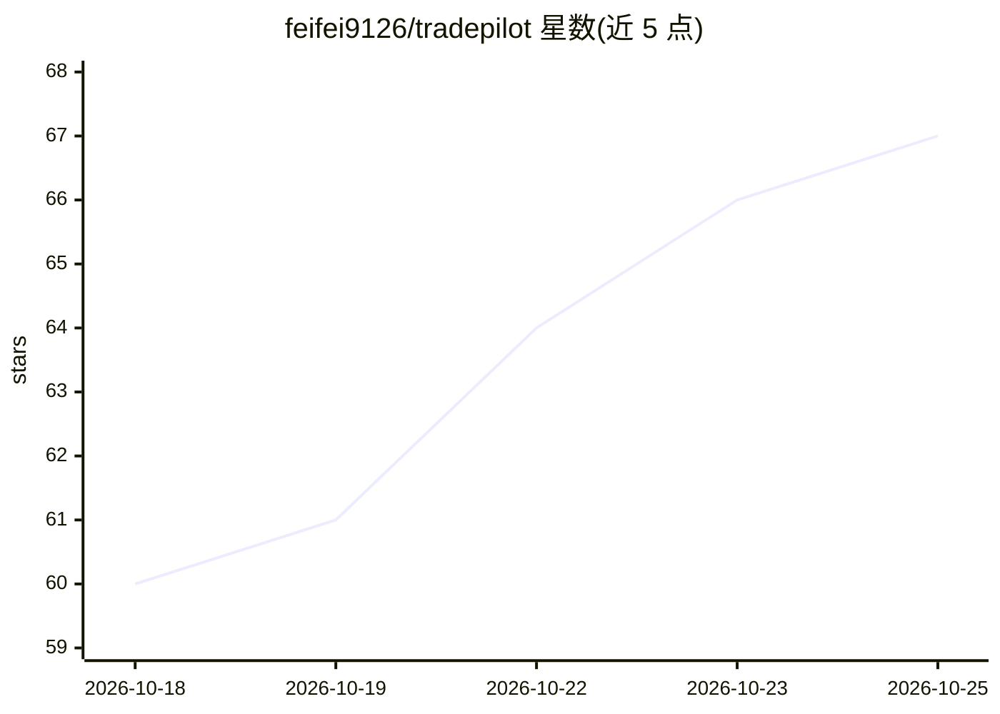

# feifei9126/tradepilot

⭐ 68 · TypeScript · NOASSERTION · 推送 2026-10-23 · [GitHub](https://github.com/feifei9126/tradepilot) · [官网](https://tradepilot.us.kg/) · 个人维护 · 中文 README

**面向小型外贸团队的开源 AI 外贸 CRM 与订单履约工作台**

基于 Next.js 16 + PostgreSQL 的可自托管外贸业务工作台，覆盖客户档案、询盘、报价、订单、出货与单证草稿的业务链。AI 功能包括：Firecrawl 抓取公开网页获客与产品资料、接入 12 个文本模型选项（OpenAI/DeepSeek/Ollama 等）生成营销与回复草稿、LiveKit + OpenAI Realtime 中英文语音客服，以及 FFmpeg/MoneyPrinterTurbo/OpenMontage 三条产品视频路径。微信服务号与 WhatsApp 消息接入代码已实现，真实收发需平台凭据；公网 SaaS 上线自述为 NO-GO，支持 Docker 与源码部署。

## 筛选速览

| 维度 | 判定 | 备注 |
|---|---|---|
| AI 角色 | `ai-enhanced` | 去掉 AI 部分产品仍成立 |
| 许可风险 | `none` | NOASSERTION |
| 部署形态 | `self-host` | docker 或自建部署 |
| 模型依赖 | local-ok | 支持本地模型 |
| 硬件要求 | — | 无带数字的原话,不猜 |
| 安装摩擦 | `low` | 无编译、无系统依赖或容器化 |
| 成熟度 | `idea` | |

## 能力要点

- 客户→询盘→报价→订单→出货一条业务链关联
- 12 个文本模型接入选项（官方/聚合/本地 Ollama）
- Firecrawl 获客搜索与产品资料采集，导入前人工确认
- 三条产品视频路径：本地 FFmpeg、MoneyPrinterTurbo、OpenMontage

## 适用场景

- 外贸团队在一个工作区管理客户、报价与订单全流程
- 用 Firecrawl 搜索公开网页线索并初筛登记
- 配置自有 AI Key 生成询盘回复与营销草稿
- 生成产品视频用于社媒推广与客户介绍

## 场景标签

`网页抓取` `视频生成` `AI 写作` · 领域:效率与自动化

## 证据(README 行号)

> L40: TradePilot 面向小型外贸团队，把公开网页获客、营销草稿、客户沟通、报价、订单与交付放进同一个可自托管工作区。各家公司使用独立数据空间，团队成员按角色和客户权限协作；账号、AI 服务、邮件和消息渠道都有配置入口与使用说明。
> L60: |AI 平台被单一供应商锁定|独立 API 配置中心，支持 12 个官方、聚合和本地接入选项|

## 星数曲线

2026-10-18 60 → 2026-10-25 67（+7）

---
*卡片 v1 · prompt 1.4 · 生成 2026-10-24 · 置信度 high · 依据 README sha `f083ca470c97` · [字段定义](../../DATASET.md)*
