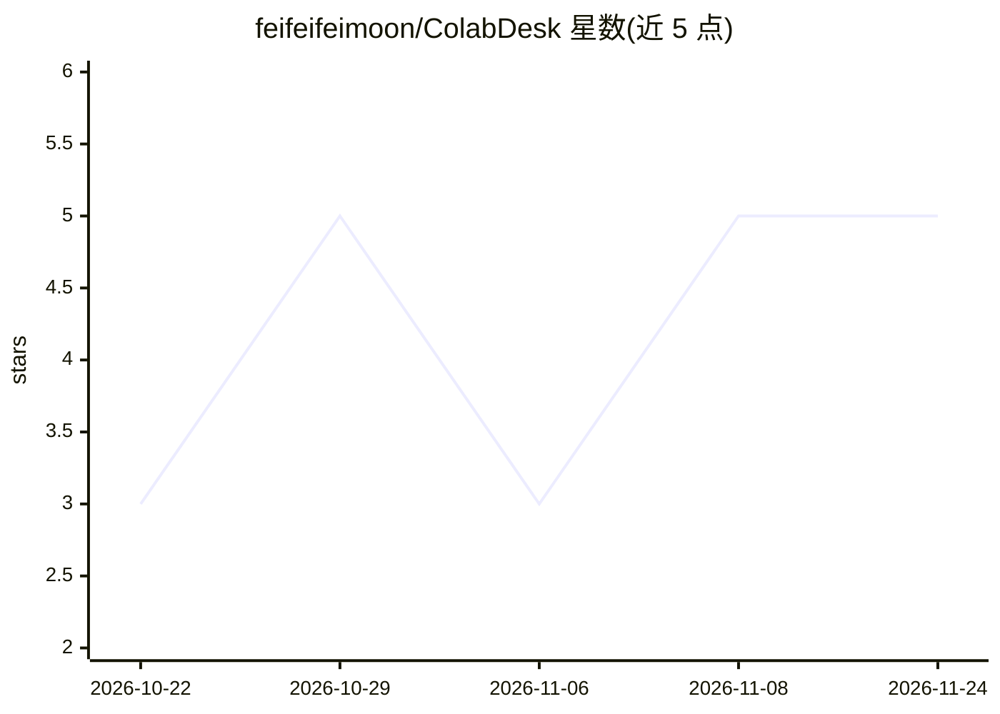

# feifeifeimoon/ColabDesk

⭐ 5 · TypeScript · Apache-2.0 · 推送 2026-11-23 · [GitHub](https://github.com/feifeifeimoon/ColabDesk) · [官网](https://colabdesk.dev) · 个人维护

**连接 Google Colab 运行时的桌面 SSH 终端与文件管理客户端**

基于 Electron 的非官方桌面客户端，面向 Google Colab 用户：通过 SSH 提供真实终端（多标签、搜索、主题配色），通过 SFTP 浏览运行时文件系统（拖拽上传/下载/删除、进度与取消），支持就地编辑（≤2 MiB 带冲突检查），可创建/停止运行时、重启内核，并记录用量数据展示 compute units 余额、消耗速率与趋势预测。还可生成 ~/.ssh/config 配置块供其他 SSH 客户端接入。安装包内置 Python 与 google-colab-cli，无需额外安装。

## 筛选速览

| 维度 | 判定 | 备注 |
|---|---|---|
| AI 角色 | `ai-enhanced` | 去掉 AI 部分产品仍成立 |
| 许可风险 | `permissive` | Apache-2.0 |
| 部署形态 | `library` | 以包/库形式分发 |
| 模型依赖 | — | README 未给出锁定关系 |
| 硬件要求 | — | 无带数字的原话,不猜 |
| 安装摩擦 | `low` | 无编译、无系统依赖或容器化 |
| 成熟度 | — | 结构信号不足 |

## 能力要点

- 基于单条 SSH 连接的 xterm 终端，每个运行时可开多标签
- SFTP 文件树：拖拽上传文件/文件夹，带进度与取消
- compute units 余额、消耗速率与日/周/月趋势（应用自行记录）
- 生成 SSH 配置块，任意 SSH 客户端可接入同一运行时

## 适用场景

- 在本地桌面终端里操作 Colab 运行时而不必用网页界面
- 在本地与 Colab 运行时之间传输和编辑文件
- 跟踪 Colab compute units 的消耗与剩余额度

## 场景标签

 · 领域:开发工具/远程开发

## 证据(README 行号)

> L6:  Platforms: Windows and macOS
> L9:  A desktop SSH console for Google Colab runtimes.
> L10:  SSH in, work in a real terminal, browse the runtime's files over SFTP, and watch the compute units it is spending 

## 星数曲线

2026-10-22 3 → 2026-11-24 5（+2）

---
*卡片 v1 · prompt 1.4 · 生成 2026-11-21 · 置信度 high · 依据 README sha `f9566b2ed022` · [字段定义](../../DATASET.md)*
