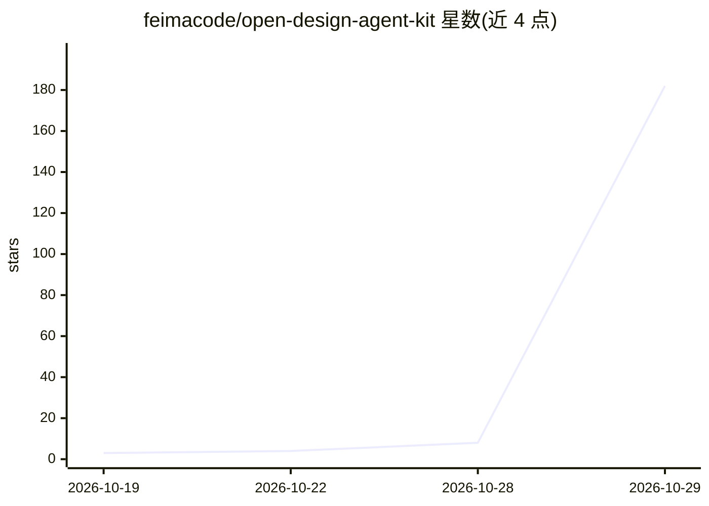

# feimacode/open-design-agent-kit

⭐ 182 · HTML · MIT · 推送 2026-10-28 · [GitHub](https://github.com/feimacode/open-design-agent-kit) · [官网](https://marketplace.visualstudio.com/items?itemName=feima.open-design-agent-kit) · 组织维护 · 中文 README

**给编码 agent 注入专业 UI 设计能力的技能包与 MCP 服务器**

面向 GitHub Copilot Chat、Claude Code、Codex、Cursor 等 agent 的设计技能套件：内置约 280 个技能与模板、198 个品牌设计系统、193 个可改写示例，通过各 agent 原生机制（VS Code 扩展、Claude 插件、.agents/skills、MCP 服务器、npx 命令）接入，用 agent 自身的模型生成仪表盘、落地页、演示文稿、移动原型等，产出为仓库内的普通文件。另可对接 Canva/Figma/Notion/Slack 等服务的官方 MCP 服务器完成导出与发布。无需桌面应用、守护进程或额外 API key。

## 筛选速览

| 维度 | 判定 | 备注 |
|---|---|---|
| AI 角色 | `ai-ecosystem` | LLM/agent 周边工具 |
| 许可风险 | `permissive` | MIT |
| 部署形态 | `library` | 以包/库形式分发 |
| 模型依赖 | — | README 未给出锁定关系 |
| 硬件要求 | — | 无带数字的原话,不猜 |
| 安装摩擦 | `low` | 无编译、无系统依赖或容器化 |
| 成熟度 | — | 结构信号不足 |

## 能力要点

- 约 280 个技能与模板、198 个品牌设计系统、193 个可改写示例
- 以 VS Code 扩展 / Claude Code 插件 / Codex skills / MCP 服务器多种方式接入
- 生成结果为仓库内普通文件，可 diff、review、commit
- 可通过 Canva/Figma/Notion/Slack 等官方 MCP 服务器直接导出与发布

## 适用场景

- 在已有 agent 对话中直接生成落地页、仪表盘、演示文稿等 UI
- 按选定品牌设计系统保持生成结果的品牌一致性
- 把生成的原型在会话内转写为应用的生产代码

## 场景标签

`Agent 框架` `代码生成` · 领域:Agent 开发

## 证据(README 行号)

> L7: Open Design Agent Kit brings Open Design's design skills, brand design systems, and remixable examples into **GitHub
> L26: - **Native to each agent.** It isn't a wrapper or a separate UI; each integration uses the agent's own mechanism. I
> L39: - **MCP server**: `npx @feimacode/open-design-agent-kit-mcp` for Cursor or any other MCP-capable agent.

## 星数曲线

2026-10-19 3 → 2026-10-29 182（+179）

---
*卡片 v1 · prompt 1.4 · 生成 2026-10-28 · 置信度 high · 依据 README sha `2a415dad5df8` · [字段定义](../../DATASET.md)*
