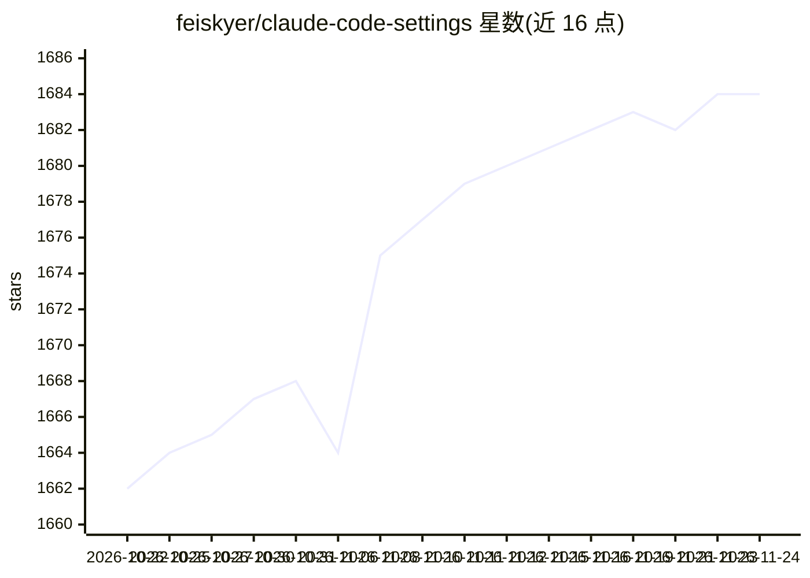

# feiskyer/claude-code-settings

⭐ 1,685 · Python · MIT · 推送 2026-11-05 · [GitHub](https://github.com/feiskyer/claude-code-settings) · [官网](https://feisky.xyz/claude-code-settings/) · 个人维护 · 中文 README

**为 Claude Code 用户提供的技能、子代理与多提供商配置模板集**

面向 Claude Code 用户的插件仓库：提供 12 个技能（深度调研、图片生成、YouTube 转录、翻译、Issue 修复、PR 审查等）、6 个专业化子代理，以及 10 余套面向不同模型提供商的 settings.json 配置模板。通过 Claude 官方 marketplace 插件安装，也支持 npx skills 单装技能或手动覆盖 ~/.claude 目录。技能部分依赖外部 CLI 与 API key（如 Codex CLI、GEMINI_API_KEY）；MIT 许可，配置模板需按账户可用模型自行调整。

## 筛选速览

| 维度 | 判定 | 备注 |
|---|---|---|
| AI 角色 | `ai-ecosystem` | LLM/agent 周边工具 |
| 许可风险 | `permissive` | MIT |
| 部署形态 | `library` | 以包/库形式分发 |
| 模型依赖 | — | README 未给出锁定关系 |
| 硬件要求 | — | 无带数字的原话,不猜 |
| 安装摩擦 | `low` | 无编译、无系统依赖或容器化 |
| 成熟度 | — | 结构信号不足 |

## 能力要点

- 12 个技能：deep-research 多 Agent 调研、图片生成、翻译、GitHub Issue 修复与 PR 审查等
- 6 个专业化子代理（pr-reviewer、ui-engineer 等）
- 10 余套模型提供商配置模板（Copilot、LiteLLM、DeepSeek、Vertex、Azure 等）
- 支持 marketplace 插件、npx skills 单技能安装与手动安装三种方式

## 适用场景

- 为 Claude Code 增加深度调研、图片生成等技能
- 通过配置模板将 Claude Code 接到 Copilot、DeepSeek 等模型端点
- 自动化修复 GitHub Issue 和审查 Pull Request

## 场景标签

`多智能体` `编码 Agent` `提示工程` · 领域:Agent 开发

## 证据(README 行号)

> L9: 给 Claude Code 加上深度调研、图片生成、GitHub 自动化等能力，配好多模型切换，开箱即用。
> L277: 配置模板目录 — 为各种模型提供商预配置的 settings.json。
> L35: 主插件包含的完整技能列表：brainstorming、codex-skill、deep-research、github-fix-issue、github-review-pr、gpt-image-skill、grill-me、han

## 星数曲线

2026-10-22 1,662 → 2026-11-24 1,684（+22）

---
*卡片 v1 · prompt 1.4 · 生成 2026-11-23 · 置信度 high · 依据 README sha `735e2e7f87b2` · [字段定义](../../DATASET.md)*
