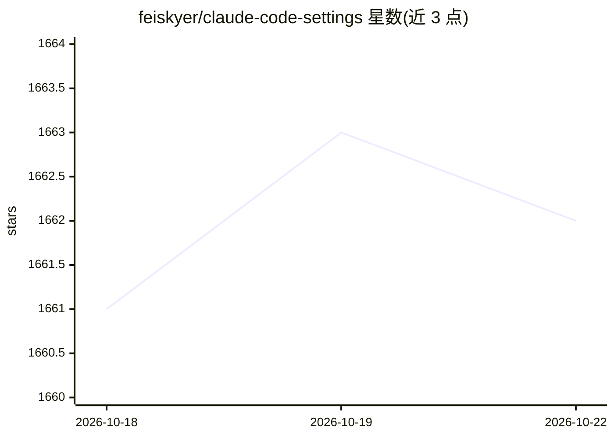

# feiskyer/claude-code-settings

⭐ 1,662 · Python · MIT · 推送 2026-09-27 · [GitHub](https://github.com/feiskyer/claude-code-settings) · [官网](https://feisky.xyz/claude-code-settings/) · 个人维护 · 中文 README

**Claude Code 的技能、子代理与配置模板集合，开箱即用**

面向 Claude Code 用户的策展配置仓库：包含 12 个技能（深度调研、图片生成、GitHub Issue/PR 自动化、翻译、会话交接等）、6 个专业子代理和 10 套模型提供商配置模板（Copilot、LiteLLM、DeepSeek、Qwen 等）。通过官方 marketplace 插件、npx skills 或手动覆盖 ~/.claude 目录安装；settings.json 默认指向 copilot-gateway 代理，切换提供商需修改 ANTHROPIC_BASE_URL。部分技能依赖外部 API key 或 CLI 工具。

## 筛选速览

| 维度 | 判定 | 备注 |
|---|---|---|
| AI 角色 | `ai-ecosystem` | LLM/agent 周边工具 |
| 许可风险 | `permissive` | MIT |
| 部署形态 | `library` | 以包/库形式分发 |
| 模型依赖 | locked-api |  |
| 硬件要求 | — | 无带数字的原话,不猜 |
| 安装摩擦 | `low` | 无编译、无系统依赖或容器化 |
| 成熟度 | — | 结构信号不足 |

## 能力要点

- 12 个技能覆盖调研、图片生成、GitHub 自动化、翻译等场景
- 多 Agent 编排的 deep-research：拆分并行子任务并聚合精修报告
- 10 套模型提供商配置模板（Copilot/LiteLLM/DeepSeek/Qwen/OpenRouter 等）
- 6 个专业子代理（PR 审查、Issue 修复、UI 开发等）

## 适用场景

- 给 Claude Code 增加深度调研和 GitHub 自动化能力
- 用现有订阅（如 GitHub Copilot）作为 Claude Code 的模型提供商
- 参考配置模板切换到 DeepSeek、Qwen 等其他模型服务

## 场景标签

`多智能体` · 领域:Agent 开发

## 证据(README 行号)

> L9: 给 Claude Code 加上深度调研、图片生成、GitHub 自动化等能力，配好多模型切换，开箱即用。
> L35: 主插件包含的完整技能列表：brainstorming、codex-skill、deep-research、github-fix-issue、github-review-pr、gpt-image-skill、grill-me、han
> L264: `agents/` 目录包含扩展 Claude Code 能力的专业化子代理。
> L277: 配置模板目录 — 为各种模型提供商预配置的 settings.json。

## 星数曲线

2026-10-18 1,661 → 2026-10-22 1,662（+1）

---
*卡片 v1 · prompt 1.4 · 生成 2026-10-21 · 置信度 high · 依据 README sha `624106ce6feb` · [字段定义](../../DATASET.md)*
