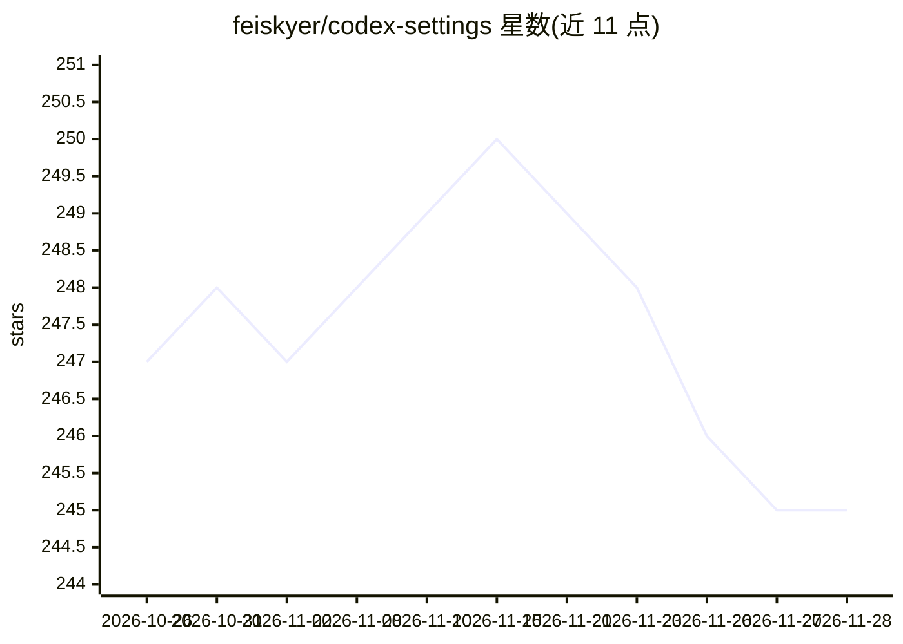

# feiskyer/codex-settings

⭐ 245 · Python · MIT · 推送 2026-11-05 · [GitHub](https://github.com/feiskyer/codex-settings) · 个人维护 · 中文 README

**为 Codex CLI 用户提供开箱即用的多模型配置与技能模板集**

面向 Codex CLI 用户的配置与技能集合，包含多模型切换 Profiles（copilot-gateway/ChatGPT/Azure OpenAI/OpenRouter/LiteLLM）、12 个 Skills（深度调研、图像生成、代码简化、Issue 修复、PR 审查、YouTube 字幕提取等）以及 Chrome DevTools MCP 浏览器自动化配置。支持三种安装方式：Codex Plugin Marketplace、npx skills CLI、克隆到 ~/.codex。默认权限为 approval_policy=never 和 danger-full-access，需注意安全。

## 筛选速览

| 维度 | 判定 | 备注 |
|---|---|---|
| AI 角色 | `ai-ecosystem` | LLM/agent 周边工具 |
| 许可风险 | `permissive` | MIT |
| 部署形态 | `library` | 以包/库形式分发 |
| 模型依赖 | locked-api |  |
| 硬件要求 | — | 无带数字的原话,不猜 |
| 安装摩擦 | `low` | 无编译、无系统依赖或容器化 |
| 成熟度 | — | 结构信号不足 |

## 能力要点

- 预置 5 种模型接入 Profiles 并支持 --profile 切换
- 12 个 Skills 覆盖调研、图像生成、GitHub 工作流等场景
- 通过 LiteLLM 网关桥接 GitHub Copilot 等第三方提供商
- 提供 codex plugin marketplace 一键安装与更新脚本

## 适用场景

- 为 Codex CLI 快速配置多模型切换环境
- 用深度调研技能生成研究报告
- 通过 Chrome DevTools MCP 调试网页并执行浏览器自动化
- 在 Codex 中调用 GPT Image/Gemini/MiniMax 生成图片

## 场景标签

`浏览器自动化` `图像生成` `代码审查` · 领域:效率与自动化

## 证据(README 行号)

> L1: # Codex CLI Skills & Profiles
> L9: 给 Codex CLI 加上深度调研、图片生成、浏览器调试等能力，配好多模型切换，开箱即用。
> L17: - **灵活切换模型**：预置 copilot-gateway、ChatGPT、Azure OpenAI、OpenRouter 和 LiteLLM/GitHub Copilot Profiles。

## 星数曲线

2026-10-26 247 → 2026-11-28 245（-2）

---
*卡片 v1 · prompt 1.4 · 生成 2026-11-26 · 置信度 mid · 依据 README sha `439a02240170` · [字段定义](../../DATASET.md)*
