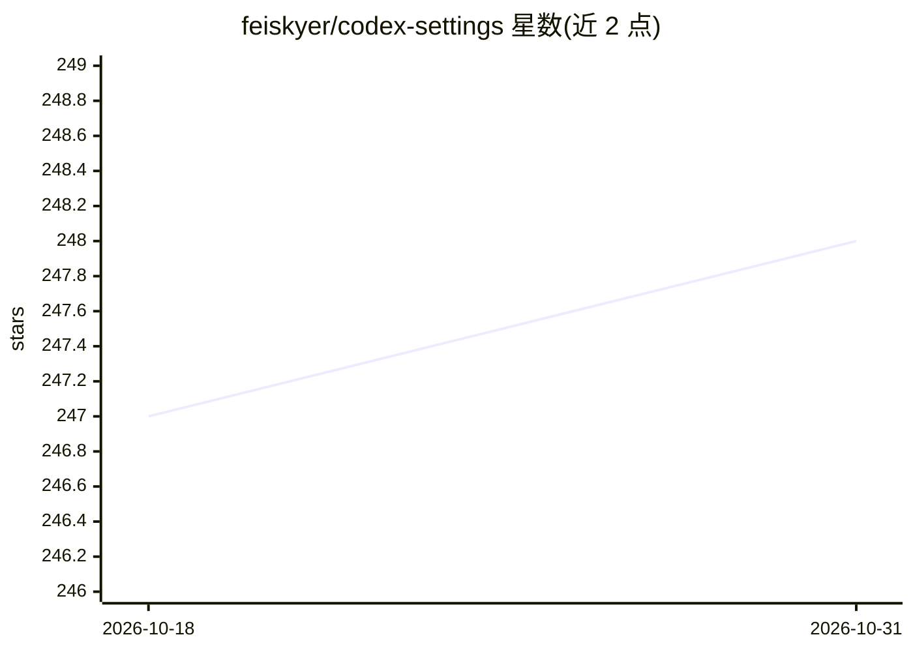

# feiskyer/codex-settings

⭐ 248 · Python · MIT · 推送 2026-09-27 · [GitHub](https://github.com/feiskyer/codex-settings) · 个人维护 · 中文 README

**Codex CLI 的配置、Profile 与技能合集，支持多模型切换**

面向 Codex CLI 用户的个人工作台配置仓库：提供根目录 config.toml 默认配置、多个模型提供商 Profile（copilot-gateway/ChatGPT/Azure OpenAI/OpenRouter/LiteLLM+GitHub Copilot），以及 12 个 Skills 覆盖需求梳理、深度调研、图像生成（OpenAI/MiniMax/Gemini）、字幕提取、GitHub Issue/PR 处理等；通过 Chrome DevTools MCP 连接浏览器调试与自动化。安装方式包括 Codex Plugin Marketplace、npx skills add、或直接克隆到 ~/.codex。默认配置采用 approval_policy=never 与 danger-full-access 沙箱，README 明确提示安全风险并给出收紧建议。

## 筛选速览

| 维度 | 判定 | 备注 |
|---|---|---|
| AI 角色 | `ai-ecosystem` | LLM/agent 周边工具 |
| 许可风险 | `permissive` | MIT |
| 部署形态 | `library` | 以包/库形式分发 |
| 模型依赖 | locked-api |  |
| 硬件要求 | — | 无带数字的原话,不猜 |
| 安装摩擦 | `low` | 无编译、无系统依赖或容器化 |
| 成熟度 | — | 结构信号不足 |

## 能力要点

- 预置 5 类模型提供商 Profile，通过 --profile 切换
- 12 个 Skills：调研、图像生成、代码简化、GitHub Issue/PR、会话交接等
- Chrome DevTools MCP 浏览器调试与自动化
- 支持 Codex Plugin Marketplace 安装与更新脚本

## 适用场景

- 快速搭建可切换多模型的 Codex CLI 环境
- 为 Codex 添加深度调研、图像生成、浏览器调试等技能
- 通过 LiteLLM 网关接入 GitHub Copilot、Kimi、DeepSeek 等第三方模型

## 场景标签

`图像生成` `浏览器自动化` · 领域:效率与自动化

## 证据(README 行号)

> L17: - **灵活切换模型**：预置 copilot-gateway、ChatGPT、Azure OpenAI、OpenRouter 和 LiteLLM/GitHub Copilot Profiles。
> L18: - **复用成熟工作流**：通过 Skills 完成需求梳理、深度调研、图像生成、字幕提取和任务交接。
> L19: - **连接真实开发环境**：通过 Chrome DevTools MCP 调试网页、检查性能并执行浏览器自动化。

## 星数曲线

2026-10-18 247 → 2026-10-31 248（+1）

---
*卡片 v1 · prompt 1.4 · 生成 2026-10-22 · 置信度 mid · 依据 README sha `a00aa68a7f19` · [字段定义](../../DATASET.md)*
