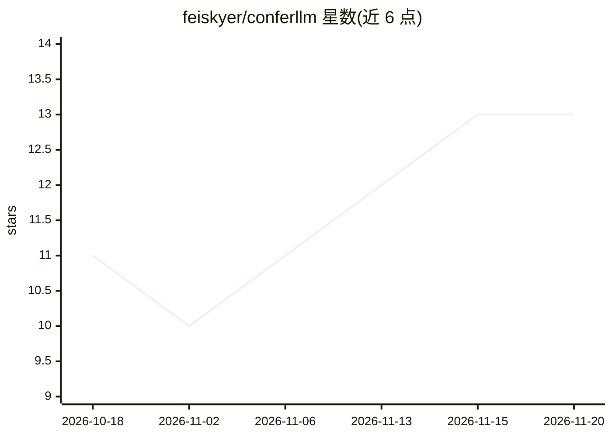

# feiskyer/conferllm

⭐ 13 · Python · MIT · 推送 2026-11-05 · [GitHub](https://github.com/feiskyer/conferllm) · 个人维护

**让 AI agent 与开发者跨模型咨询协作的 CLI/MCP 工具**

基于 LiteLLM 的极简 agent 工具套件，以 CLI、Agent Skill 和 MCP Server 三种形态提供。它将配置的多个模型接入统一别名体系，被委派的模型可访问 10 个宿主工具（shell、git、文件读写）以在本机执行操作，会话以 JSONL 持久化并可恢复。面向使用 Claude Code、Codex、Cursor 等 agent 的开发者，用于获取第二意见、委派子任务与跨模型协作。限制：仅支持 macOS/Linux（POSIX 文件锁），需 Python 3.10+。

## 筛选速览

| 维度 | 判定 | 备注 |
|---|---|---|
| AI 角色 | `ai-ecosystem` | LLM/agent 周边工具 |
| 许可风险 | `permissive` | MIT |
| 部署形态 | `library` | 以包/库形式分发 |
| 模型依赖 | local-ok | 支持本地模型 |
| 硬件要求 | — | 无带数字的原话,不猜 |
| 安装摩擦 | `low` | 无编译、无系统依赖或容器化 |
| 成熟度 | — | 结构信号不足 |

## 能力要点

- 经 LiteLLM 连接 100+ 提供商，本地别名统一管理
- 被委派模型获得 10 个原生宿主工具（shell/git/文件操作）
- JSONL 持久化多轮会话，--session 随时恢复
- 双形态集成：Agent Skill 与 MCP Server（stdio/SSE/HTTP）

## 适用场景

- 让 Claude Code 等编码 agent 咨询其他模型获取第二意见
- 将特定子任务（如数学证明、视觉分析）委派给专门模型
- 在本地仓库上让外部模型读写文件并执行命令协作
- 对同一问题并排比较多个模型的表现

## 场景标签

`模型网关` · 领域:Agent 开发

## 证据(README 行号)

> L8: ConferLLM is a minimalist agent harness with multi-model support and essential host tools. It enables AI agents (suc
> L19: - **Multi-Model Delegation:** Connect to 100+ providers via LiteLLM (OpenAI, Anthropic, Gemini, DeepSeek, local Oll
> L115: ConferLLM includes a full-featured MCP (Model Context Protocol) server over stdio, SSE, or streamable HTTP.

## 星数曲线

2026-10-18 11 → 2026-11-20 13（+2）

---
*卡片 v1 · prompt 1.4 · 生成 2026-11-18 · 置信度 high · 依据 README sha `c15c1cdb218f` · [字段定义](../../DATASET.md)*
