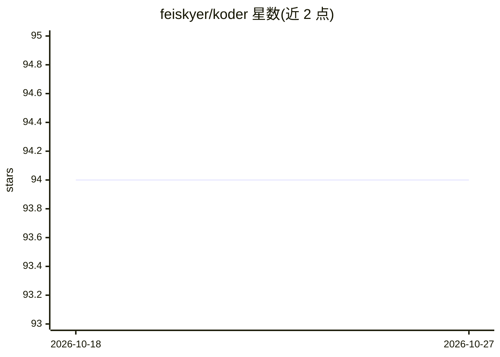

# feiskyer/koder

⭐ 94 · Python · MIT · 推送 2026-09-14 · [GitHub](https://github.com/feiskyer/koder) · 个人维护

**终端 AI 编程助手：TUI 会话、多模型接入与本地状态**

实验性（Alpha）Python 终端 AI 编程助手：流式 TUI、SQLite 持久会话、目标与 cron 定时循环、仓库感知工具（文件/搜索/shell/git）、技能与插件扩展、MCP 集成、权限与沙箱控制、后台子代理与本地团队。模型接入支持 OpenAI、Anthropic、Google、GitHub Copilot、Azure、OpenRouter 及 100+ LiteLLM 提供商，OAuth 订阅登录与自定义 base URL；状态存储在本地 ~/.koder/，提示词发送至所配置的提供商。需 Python 3.11+ 与模型凭证。

## 筛选速览

| 维度 | 判定 | 备注 |
|---|---|---|
| AI 角色 | `ai-native` | 本体是模型或模型工具 |
| 许可风险 | `permissive` | MIT |
| 部署形态 | `library` | 以包/库形式分发 |
| 模型依赖 | locked-api |  |
| 硬件要求 | — | 无带数字的原话,不猜 |
| 安装摩擦 | `low` | 无编译、无系统依赖或容器化 |
| 成熟度 | `idea` | |

## 能力要点

- 流式 TUI：斜杠命令、shell 模式、文件提及、历史搜索、可选语音输入
- 多提供商路由：KODER_* 环境变量、专属 key、OAuth 订阅登录、自定义 base URL
- 持久会话：SQLite 转录、命名会话、目标与 token 预算、cron 定时循环
- 扩展体系：技能、验证技能、插件、MCP 服务器、channels 与 Magic Docs

## 适用场景

- 在终端里让 AI 代理阅读仓库、修测试、审查 diff
- 跨多个模型提供商切换使用同一套本地工作流
- 用定时循环和会话目标管理长时间运行的开发任务

## 场景标签

`编码 Agent` · 领域:编码与开发

## 证据(README 行号)

> L9: Koder is an experimental, open-source AI coding assistant for the terminal. It combines a streaming TUI, persistent 
> L28: - Bring your own model: OpenAI, Anthropic, Google/Gemini, GitHub Copilot, Azure, OAuth-backed subscriptions, OpenRo

## 星数曲线

2026-10-18 94 → 2026-10-27 94（+0）

---
*卡片 v1 · prompt 1.4 · 生成 2026-10-23 · 置信度 high · 依据 README sha `083fa360e29c` · [字段定义](../../DATASET.md)*
