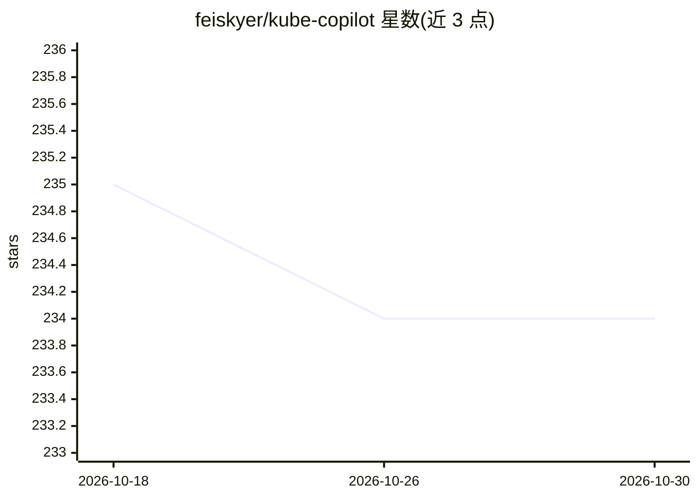

# feiskyer/kube-copilot

⭐ 234 · Go · Apache-2.0 · 推送 2025-11-21 · [GitHub](https://github.com/feiskyer/kube-copilot) · 个人维护

**面向运维的 Kubernetes AI 助手 CLI：诊断、审计与生成清单**

用 Go 编写的命令行工具，通过 LLM（OpenAI/Azure OpenAI/Anthropic Claude/Google Gemini/Ollama 等 OpenAI 兼容接口）辅助 Kubernetes 集群管理。提供 analyze/audit/diagnose/execute/generate 五个子命令，分别分析资源问题、用 trivy 审计 Pod 安全、诊断故障、按自然语言指令执行操作、生成并确认应用 Kubernetes manifests。集群访问依赖本地 kubectl，audit 命令依赖 trivy，并支持 MCP 协议接入外部工具。另有同项目的 Python 版本仓库。

## 筛选速览

| 维度 | 判定 | 备注 |
|---|---|---|
| AI 角色 | `ai-native` | 本体是模型或模型工具 |
| 许可风险 | `permissive` | Apache-2.0 |
| 部署形态 | `library` | 以包/库形式分发 |
| 模型依赖 | local-ok | 支持本地模型 |
| 硬件要求 | — | 无带数字的原话,不猜 |
| 安装摩擦 | `low` | 无编译、无系统依赖或容器化 |
| 成熟度 | — | 结构信号不足 |

## 能力要点

- analyze/audit/diagnose/execute/generate 五个子命令覆盖诊断、审计与清单生成
- 支持 OpenAI、Azure OpenAI、Anthropic Claude、Google Gemini 及 Ollama 等 OpenAI 兼容接口
- 通过 MCP 协议接入外部工具（diagnose 与 execute 子命令）
- 调用原生 kubectl 与 trivy 完成集群访问与漏洞扫描

## 适用场景

- 让 AI 分析 Kubernetes 资源的潜在问题并诊断 Pod 故障
- 用自然语言指令执行集群操作
- 按提示词生成 Kubernetes manifests 并确认后应用
- 结合 trivy 对 Pod 做安全漏洞审计

## 场景标签

`AI 助手` `网络安全` `代码生成` · 领域:编码与开发

## 证据(README 行号)

> L3: Kubernetes Copilot powered by LLM, which leverages advanced language models to streamline and enhance Kubernetes clu
> L7: - Automate Kubernetes cluster operations using large language models.
> L10: - Generate Kubernetes manifests based on provided prompt instructions.

## 星数曲线

2026-10-18 235 → 2026-10-30 234（-1）

---
*卡片 v1 · prompt 1.4 · 生成 2026-10-22 · 置信度 high · 依据 README sha `990c54d388a3` · [字段定义](../../DATASET.md)*
