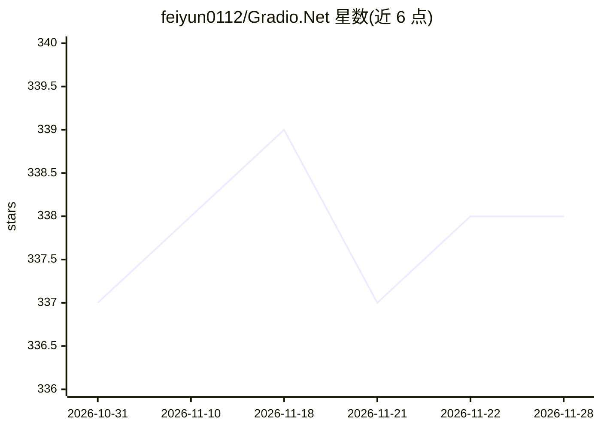

# feiyun0112/Gradio.Net

⭐ 338 · C# · Apache-2.0 · 推送 2026-11-22 · [GitHub](https://github.com/feiyun0112/Gradio.Net) · 个人维护 · 中文 README

**给 .NET 开发者用的 Gradio 移植：为模型或方法快速建 Web UI**

Python 库 Gradio 的 .NET 移植：通过 gr.Interface / gr.Blocks 工厂函数把任意 C# 方法包装为浏览器可访问的 Web 应用，前端复用 Python 版编译产物，协议与配置一致。提供 AddGradio()/UseGradio() 与 ASP.NET Core 集成，支持聊天、流式输出、文件上传、多媒体、多页面、主题与图表组件；带十个可 dotnet run 的示例工程和 Python→C# 迁移对照表。无前端经验要求，MCP 工具等成员在当前版本尚未实现。

## 筛选速览

| 维度 | 判定 | 备注 |
|---|---|---|
| AI 角色 | `ai-ecosystem` | LLM/agent 周边工具 |
| 许可风险 | `permissive` | Apache-2.0 |
| 部署形态 | `None` |  |
| 模型依赖 | — | README 未给出锁定关系 |
| 硬件要求 | — | 无带数字的原话,不猜 |
| 安装摩擦 | `medium` | 含编译或系统依赖之一 |
| 成熟度 | — | 结构信号不足 |

## 能力要点

- gr.Interface 将任意 C# 方法包装为页面，无需布局代码
- 与 ASP.NET Core 集成：AddGradio() 注册、UseGradio() 承载路由/资产/队列
- 前端与协议沿用 Python 版 Gradio 编译产物
- 十个离线示例工程覆盖聊天、流式、文件、多页面、图表等

## 适用场景

- 为 C# 机器学习模型快速生成可交互的演示页面
- 在现有 ASP.NET Core 项目中为 API 增加浏览器界面
- Python Gradio 用户将现有应用迁移到 .NET

## 场景标签

 · 领域:机器学习应用开发工具/用户界面框架

## 证据(README 行号)

> L11: Gradio for .NET — a port of Gradio, the Python package
> L15: With Gradio.Net you build a UI for a model, an API or any C# method in a few lines: users drag in
> L54: `AddGradio()` registers the kernel; write the page, hand it to `UseGradio(page)`, and the host serves

## 星数曲线

2026-10-31 337 → 2026-11-28 338（+1）

---
*卡片 v1 · prompt 1.4 · 生成 2026-11-25 · 置信度 high · 依据 README sha `9380b585d79a` · [字段定义](../../DATASET.md)*
