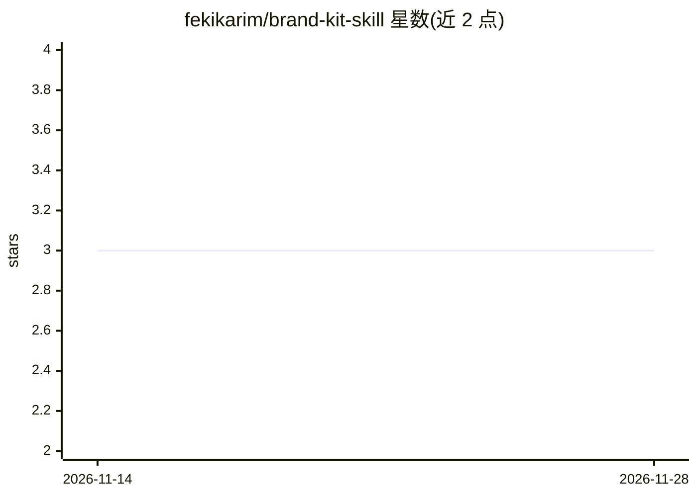

# fekikarim/brand-kit-skill

⭐ 3 · Shell · MIT · 推送 2026-11-09 · [GitHub](https://github.com/fekikarim/brand-kit-skill) · 个人维护

**给 AI 编程代理生成完整品牌视觉包的技能**

一个以 SKILL.md 指令文件形式分发的 AI agent 技能：将品牌描述交给 AI 编码助手后，按五步流程（提问→设计标志→选定色板与字体→脚本生成文件→打包 zip）产出 200+ 文件，含多尺寸 logo、favicon/PWA/iOS/Android 图标、社媒素材、背景与品牌手册。需 Python 3.9 与 cairosvg/Pillow/fonttools 依赖；标志与色板需人工确认后才继续生成。README 声明产物版权归用户，生成中下载的字体遵循 OFL 1.1。

## 筛选速览

| 维度 | 判定 | 备注 |
|---|---|---|
| AI 角色 | `ai-native` | 本体是模型或模型工具 |
| 许可风险 | `permissive` | MIT |
| 部署形态 | `library` | 以包/库形式分发 |
| 模型依赖 | — | README 未给出锁定关系 |
| 硬件要求 | — | 无带数字的原话,不猜 |
| 安装摩擦 | `low` | 无编译、无系统依赖或容器化 |
| 成熟度 | — | 结构信号不足 |

## 能力要点

- 输出 200+ 文件的品牌包：logo、图标、社媒素材、背景、品牌手册
- 标志与色板环节设人工确认门（Gate 1/2）
- 兼容 Antigravity、Claude Code、Cursor、Windsurf、Copilot、Gemini CLI 等 IDE 接入方式
- 内置设计标准检查：WCAG AA 对比度、16px favicon 可读性、矢量优先

## 适用场景

- 为初创项目一键生成全套品牌素材 zip
- 为产品补齐各平台图标（favicon、PWA、iOS、Android）
- 生成带 WCAG AA 对比度校验的品牌配色与字体规范

## 场景标签

`图像生成` · 领域:内容生成

## 证据(README 行号)

> L14: > **Give an AI agent a brand description → get a complete, production-ready brand kit zip.**
> L21: **Brand Identity Kit** is an AI agent skill — a set of structured instructions that teaches any capable AI coding a
> L28: 4. ⚡ **Generates** every deliverable automatically via Python scripts

## 星数曲线

2026-11-14 3 → 2026-11-28 3（+0）

---
*卡片 v1 · prompt 1.4 · 生成 2026-11-22 · 置信度 mid · 依据 README sha `04addbb37bc9` · [字段定义](../../DATASET.md)*
