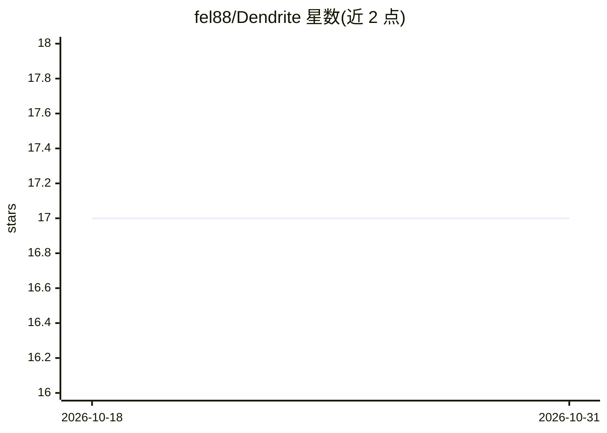

# fel88/Dendrite

⭐ 17 · C# · MIT · 推送 2025-11-08 · [GitHub](https://github.com/fel88/Dendrite) · 个人维护

**ONNX 模型的图查看/编辑与推理环境构建工具**

面向 ONNX 模型的节点图编辑器：提供模型图查看与编辑、以及可视化推理环境构建——通过添加 Net 节点加载 .onnx 文件，串联预/后处理节点（NCHW、Mean/Std 归一化、boxes 解码等）、图像源节点后运行推理并查看输出。推理环境可保存为 .den 文件复用，配套控制台程序支持以 .den 文件加输入图像/视频/声音执行推理并输出结果。项目标注为 WIP。

## 筛选速览

| 维度 | 判定 | 备注 |
|---|---|---|
| AI 角色 | `ai-ecosystem` | LLM/agent 周边工具 |
| 许可风险 | `permissive` | MIT |
| 部署形态 | `None` |  |
| 模型依赖 | — | README 未给出锁定关系 |
| 硬件要求 | — | 无带数字的原话,不猜 |
| 安装摩擦 | `low` | 无编译、无系统依赖或容器化 |
| 成熟度 | `idea` | |

## 能力要点

- 节点图式构建推理流水线（模型+预/后处理+图像源）
- 推理环境可保存为 .den 文件复用
- 控制台模式支持图像/视频/声音输入执行推理
- 现成推理环境可从配套仓库下载

## 适用场景

- 可视化查看与编辑 ONNX 模型结构
- 为 ONNX 模型搭建含前后处理的推理流水线并调试
- 用控制台批量对图像/视频执行保存的推理环境

## 场景标签

`推理引擎` · 领域:训练与推理

## 证据(README 行号)

> L2: ONNX viewer/editor/inference
> L10: 1. Open graph editor (Model->Inference->Manager)

## 星数曲线

2026-10-18 17 → 2026-10-31 17（+0）

---
*卡片 v1 · prompt 1.4 · 生成 2026-10-29 · 置信度 high · 依据 README sha `62171fa55284` · [字段定义](../../DATASET.md)*
