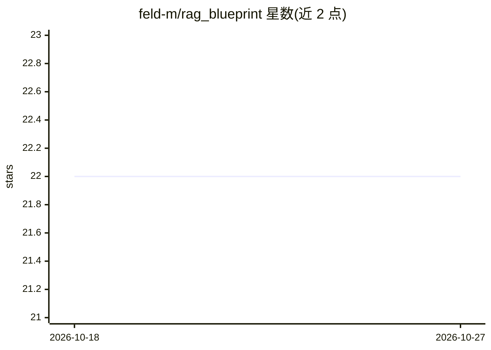

# feld-m/rag_blueprint

⭐ 22 · Python · MIT · 推送 2025-11-26 · [GitHub](https://github.com/feld-m/rag_blueprint) · [官网](https://feld-m.github.io/rag_blueprint/) · 组织维护

**构建与部署生产级 RAG 系统的模块化框架，内置评测与监控**

开源 RAG 框架，覆盖抽取（Notion/Confluence/PDF 等数据源）、嵌入（markdown 感知切分、多种嵌入模型）、增强（检索与聊天引擎，Chainlit 界面）与评测（RAGAS 指标、人工反馈收集）四段流水线，配套 PostgreSQL 与 Docker 基础设施。语言模型经 LiteLLM 接入 OpenAI/Google/Anthropic 及本地 LLM，向量库支持 Qdrant/Chroma/PGVector，观测与追踪由 Langfuse 提供。README 将详细安装步骤置于 Quickstart 文档中，页面本身未给出具体命令。

## 筛选速览

| 维度 | 判定 | 备注 |
|---|---|---|
| AI 角色 | `ai-ecosystem` | LLM/agent 周边工具 |
| 许可风险 | `permissive` | MIT |
| 部署形态 | `None` |  |
| 模型依赖 | — | README 未给出锁定关系 |
| 硬件要求 | — | 无带数字的原话,不猜 |
| 安装摩擦 | `low` | 无编译、无系统依赖或容器化 |
| 成熟度 | — | 结构信号不足 |

## 能力要点

- 抽取/嵌入/增强/评测四段式流水线，各模块有独立 readme
- RAGAS 评测指标与 Chainlit/Langfuse 人工反馈收集
- LiteLLM 接入多家提供商及本地 LLM
- 支持 Qdrant/Chroma/PGVector 三种向量库

## 适用场景

- 搭建带评测与监控的生产级知识库问答系统
- 从 Notion/Confluence/PDF 等数据源构建可检索知识库
- 收集用户反馈构建评测数据集并持续评估 RAG 表现

## 场景标签

`RAG` `文档问答` `模型评测` · 领域:评测与运维

## 证据(README 行号)

> L3: A comprehensive open-source framework for building production-ready Retrieval-Augmented Generation (RAG) systems. Th
> L18: - **Evaluation**: Comprehensive evaluation metrics using RAGAS
> L24: Python • LlamaIndex • Chainlit • Langfuse • RAGAS

## 星数曲线

2026-10-18 22 → 2026-10-27 22（+0）

---
*卡片 v1 · prompt 1.4 · 生成 2026-10-27 · 置信度 high · 依据 README sha `bd6aba50affe` · [字段定义](../../DATASET.md)*
