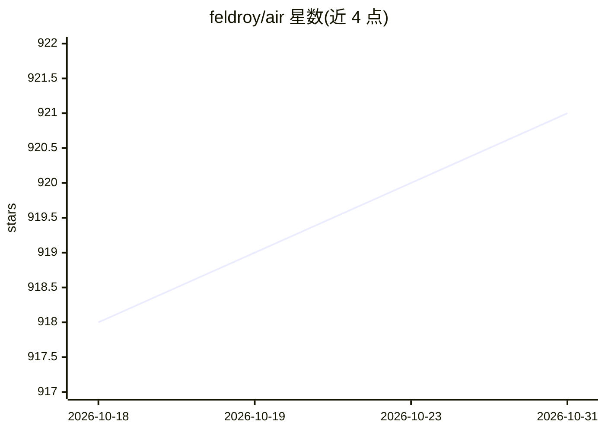

# feldroy/air

⭐ 921 · Python · MIT · 推送 2026-10-23 · [GitHub](https://github.com/feldroy/air) · [官网](https://airwebframework.org) · 个人维护

**面向 AI 编写的 Web 框架，基于 FastAPI/Pydantic/HTMX**

由《Two Scoops of Django》作者开发的 Python Web 框架，构建于 FastAPI、Pydantic 和 HTMX 之上。核心设计目标：API 全面类型化、无隐式行为，使 AI 编码助手无需外部文档即可理解框架；提供 llms-full.txt/llms.txt 供 AI 上下文使用。功能包括 Air Tags（Python 类渲染 HTML）、Jinja 混用、pydantic 驱动的 HTML 表单校验、HTMX 工具，以及挂载或包裹 FastAPI 子应用。README 明确声明处于 alpha 阶段，API 可能在版本间变更。通过 uv/pip 从 PyPI 安装。

## 筛选速览

| 维度 | 判定 | 备注 |
|---|---|---|
| AI 角色 | `ai-enhanced` | 去掉 AI 部分产品仍成立 |
| 许可风险 | `permissive` | MIT |
| 部署形态 | `library` | 以包/库形式分发 |
| 模型依赖 | — | README 未给出锁定关系 |
| 硬件要求 | — | 无带数字的原话,不猜 |
| 安装摩擦 | `low` | 无编译、无系统依赖或容器化 |
| 成熟度 | `idea` | |

## 能力要点

- API 全类型化且文档内置于源码，供 AI 编码助手直接读取
- Air Tags：用 Python 类型化类生成 HTML，Jinja 与其可混用
- pydantic 驱动的 HTML 表单校验（依赖注入或视图内两种方式）
- 可与 FastAPI 子应用挂载或包裹单一实例共存

## 适用场景

- 让 AI 助手或编辑器直接生成并维护 Web 页面代码
- 在单个项目中同时提供 API 与 HTML 页面
- 用 Python 类型检查器校验 HTML 结构

## 场景标签

 · 领域:Web 开发框架

## 证据(README 行号)

> L37: - **Designed for AI to write** - No magic, no implicit behavior. Comprehensive types and docstrings mean AI agents 
> L79: Air's API is fully typed and comprehensively documented in-source. AI coding assistants can understand the framewor
> L83: Third-party context providers: Code Wiki by Google, DeepWiki by Devin.

## 星数曲线

2026-10-18 918 → 2026-10-31 921（+3）

---
*卡片 v1 · prompt 1.4 · 生成 2026-10-21 · 置信度 mid · 依据 README sha `93ee746032ce` · [字段定义](../../DATASET.md)*
