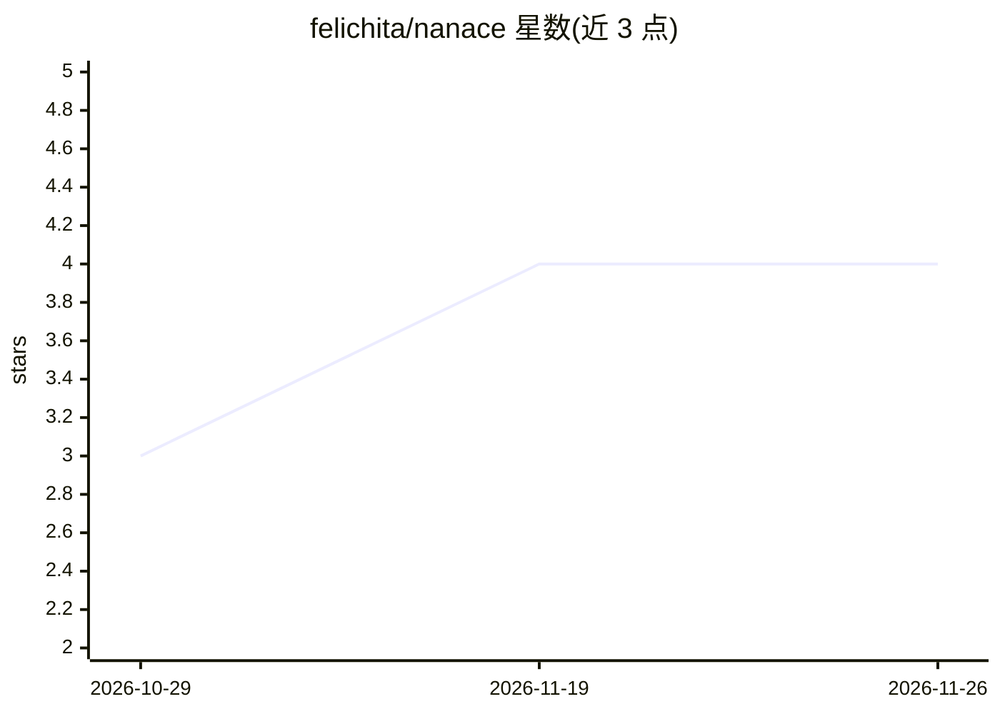

# felichita/nanace

⭐ 4 · Rust · Apache-2.0 · 推送 2026-11-18 · [GitHub](https://github.com/felichita/nanace) · [官网](https://github.com/felichita/nanace/releases) · 个人维护

**自托管团队知识库，通过 MCP 与 Claude 共享**

多租户 Markdown 知识库，提供团队级 RBAC 与语义搜索（内置 bge-small-en-v1.5 嵌入模型，数据存于 PostgreSQL 与 Qdrant）。通过捆绑的 MCP 服务器接入 Claude Code 与 Claude Desktop，支持只读查询与授权后的页面写入；附带 Claude Code 技能可将工作日志写入任务页面并维护 Wiki 索引，另提供代理间 P2P 问答功能。服务端以 Docker 镜像发布，桌面应用基于 Tauri 构建。

## 筛选速览

| 维度 | 判定 | 备注 |
|---|---|---|
| AI 角色 | `ai-enhanced` | 去掉 AI 部分产品仍成立 |
| 许可风险 | `permissive` | Apache-2.0 |
| 部署形态 | `self-host` | docker 或自建部署 |
| 模型依赖 | — | README 未给出锁定关系 |
| 硬件要求 | — | 无带数字的原话,不猜 |
| 安装摩擦 | `low` | 无编译、无系统依赖或容器化 |
| 成熟度 | — | 结构信号不足 |

## 能力要点

- 多租户 Markdown 知识库与团队级 RBAC
- 基于 Qdrant 的语义搜索，嵌入模型本地缓存运行
- 通过 MCP 服务器接入 Claude Code 与 Claude Desktop
- 代理间 P2P 直问（经团队策略页与 owner 授权控制）

## 适用场景

- 团队自托管共享笔记与文档知识库
- 让 Claude 检索团队文档并保存工作笔记
- 团队成员的 AI 代理之间跨设备互问知识

## 场景标签

`知识库管理` `语义搜索` · 领域:知识与检索

## 证据(README 行号)

> L3: Multi-tenant markdown knowledge base with team-level RBAC and semantic search,
> L33: ## Connect Claude (MCP)

## 星数曲线

2026-10-29 3 → 2026-11-26 4（+1）

---
*卡片 v1 · prompt 1.4 · 生成 2026-11-21 · 置信度 mid · 依据 README sha `eb1f04a5a8bf` · [字段定义](../../DATASET.md)*
