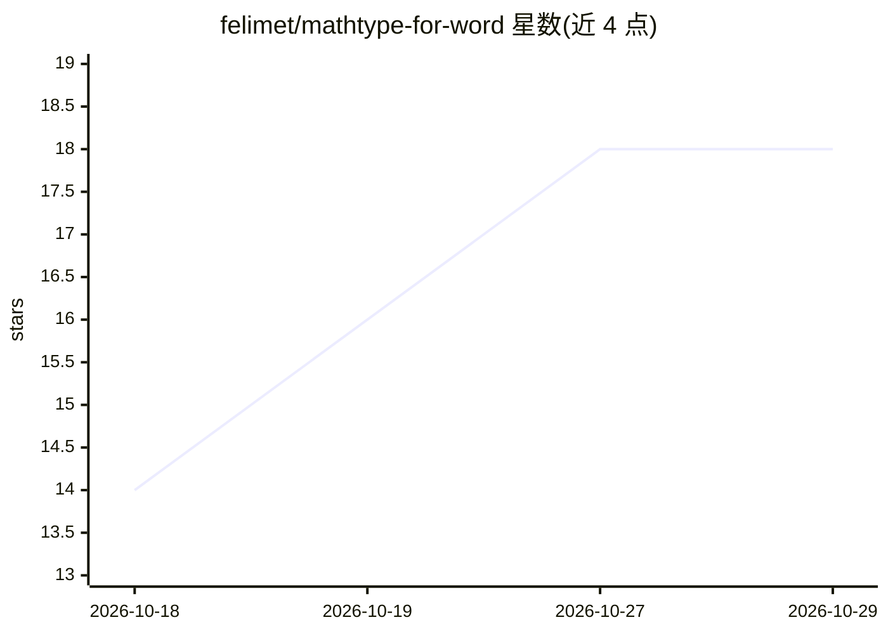

# felimet/mathtype-for-word

⭐ 18 · HTML · MIT · 推送 2026-10-13 · [GitHub](https://github.com/felimet/mathtype-for-word) · 个人维护 · 中文 README

**让 AI agent 在 Word/PowerPoint 中创建可编辑 MathType 公式的技能与 MCP 服务器**

面向 Codex、Claude Code/Claude Desktop、ChatGPT 的可安装技能包、插件与本地 stdio MCP 服务器：通过 Windows Office COM 自动化与桌面版 MathType，在 DOCX/PPTX 中插入真正的可编辑 Equation.DSMT4 对象、Word 原生公式编号与动态交叉引用；可扫描全文将纯文本数学片段分类并标记。桥接层为 PowerShell 7 脚本（缺失时可自动为当前用户安装），服务器仅用 Python 标准库。限制：仅 Windows 10/11、需桌面版 MathType 与 Office；ChatGPT 需远程端点或隧道。

## 筛选速览

| 维度 | 判定 | 备注 |
|---|---|---|
| AI 角色 | `ai-ecosystem` | LLM/agent 周边工具 |
| 许可风险 | `permissive` | MIT |
| 部署形态 | `desktop` | 安装包/桌面程序 |
| 模型依赖 | locked-api |  |
| 硬件要求 | — | 无带数字的原话,不猜 |
| 安装摩擦 | `low` | 无编译、无系统依赖或容器化 |
| 成熟度 | — | 结构信号不足 |

## 能力要点

- 生成真正可编辑的 Equation.DSMT4 对象而非 OMath/图片/Unicode 文本
- Word 原生公式编号与动态 MathType 交叉引用
- 只读扫描将手稿纯文本数学分类为行内/无编号/编号/引用并标记
- PowerShell 7 缺失时自动为当前用户安装（校验哈希与签名，无需管理员）

## 适用场景

- 让 Claude Code/Codex 直接编辑论文 Word 文档中的公式与编号引用
- 把纯文本排版的数学稿批量转为可编辑 MathType 公式
- 在 PowerPoint 中插入居中浮动 MathType 公式

## 场景标签

`AI 写作` · 领域:内容生成

## 证据(README 行号)

> L5: An installable AI Agent skill, Codex/Claude plugin, and MCP server for creating editable MathType 7 equations in Mic
> L19: - Provides a portable cross-agent skill/plugin plus a local MCP server for Codex and Claude hosts; ChatGPT uses the

## 星数曲线

2026-10-18 14 → 2026-10-29 18（+4）

---
*卡片 v1 · prompt 1.4 · 生成 2026-10-29 · 置信度 high · 依据 README sha `63d57d8ffab9` · [字段定义](../../DATASET.md)*
