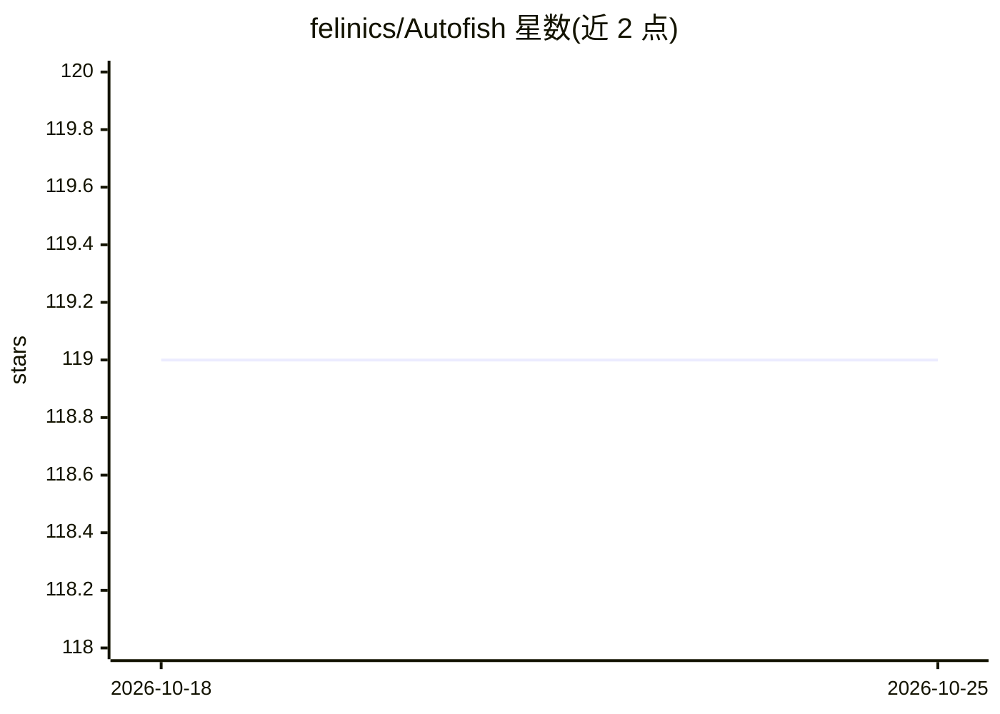

# felinics/Autofish

⭐ 119 · Rust · Apache-2.0 · 推送 2026-08-29 · [GitHub](https://github.com/felinics/Autofish) · 个人维护 · 中文 README

**给 AI agent 用的 Android 设备控制执行层**

面向 agent 与多 agent 系统的 Android 控制基础设施，由设备端前台服务（HTTP API，提供截屏、UI 树检查、点击/滑动/输入、覆盖层标注）与 Rust 编写的 CLI `af`（npm 分发）组成。agent 通过稳定 ref 而非坐标操作 UI，每步动作后验证结果，CLI 用 SQLite 维护事件、状态转移、恢复策略与 agent 笔记的本地工具记忆。明确不做规划、不调用 LLM，支持 Codex 与 Claude Code 技能文件安装。

## 筛选速览

| 维度 | 判定 | 备注 |
|---|---|---|
| AI 角色 | `ai-ecosystem` | LLM/agent 周边工具 |
| 许可风险 | `permissive` | Apache-2.0 |
| 部署形态 | `library` | 以包/库形式分发 |
| 模型依赖 | — | README 未给出锁定关系 |
| 硬件要求 | — | 无带数字的原话,不猜 |
| 安装摩擦 | `medium` | 含编译或系统依赖之一 |
| 成熟度 | — | 结构信号不足 |

## 能力要点

- 设备端服务 + CLI 双组件架构，ref-based 交互替代脆弱坐标
- 观察→动作→验证→恢复的闭环流程与确定性退出码
- SQLite 工具记忆：事件、状态转移、恢复策略、agent 笔记
- 提供 Codex / Claude Code 技能文件（SKILL.md）安装

## 适用场景

- 让 AI agent 可靠地操控 Android 设备完成设置变更等任务
- 多 agent 系统接入统一的设备控制执行层
- 自动化流程中记录并复用成功的导航与恢复经验

## 场景标签

`GUI 自动化` `Agent 记忆` · 领域:Agent 开发

## 证据(README 行号)

> L5: **Android control infrastructure for agents and multi-agent systems.**
> L7: Autofish gives any agent a stable, explicit, and observable Android execution layer: inspect the screen, act through
> L211: |**Single responsibility**|Android observation and control. No planning, no LLM calls, no workflow engine.|

## 星数曲线

2026-10-18 119 → 2026-10-25 119（+0）

---
*卡片 v1 · prompt 1.4 · 生成 2026-10-23 · 置信度 high · 依据 README sha `73daf4608cc6` · [字段定义](../../DATASET.md)*
