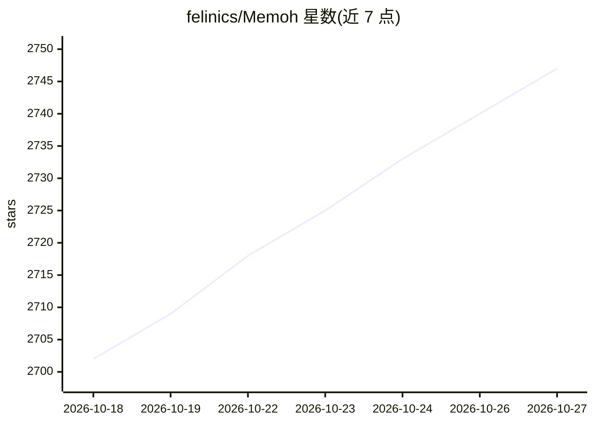

# felinics/Memoh

⭐ 2,747 · Go · AGPL-3.0 · 推送 2026-10-26 · [GitHub](https://github.com/felinics/Memoh) · [官网](https://memoh.ai) · 组织维护 · 中文 README

**开源多 agent 平台：每个 agent 配专属云电脑与长期记忆**

Memoh 是开源多 agent 平台，为每个 agent 分配独立的云工作区，含文件系统、桌面、浏览器、网络与长期记忆，agent 在笔记本关闭后仍 24/7 在线。支持自带 API key 运行内置 agent，或在 Memoh 工作区内托管已有的 Claude Code、Codex 等 coding agent。可通过 Telegram、Discord、Lark、微信、Web UI 等对话，支持 MCP 工具调用与定时任务。提供 Memoh Cloud 托管与自托管两条路径（curl 脚本或 docker compose）。

## 筛选速览

| 维度 | 判定 | 备注 |
|---|---|---|
| AI 角色 | `ai-ecosystem` | LLM/agent 周边工具 |
| 许可风险 | `viral` | AGPL-3.0 |
| 部署形态 | `self-host` | docker 或自建部署 |
| 模型依赖 | — | README 未给出锁定关系 |
| 硬件要求 | — | 无带数字的原话,不猜 |
| 安装摩擦 | `low` | 无编译、无系统依赖或容器化 |
| 成熟度 | — | 结构信号不足 |

## 能力要点

- 每个 agent 独立工作区（文件系统/桌面/浏览器/网络）与跨会话长期记忆
- 支持托管已有 Claude Code / Codex agent，自带 API key
- 多渠道对话：Telegram、Discord、Lark、微信、Web UI 等
- 自托管 curl 一键安装或 docker compose，支持 CN 镜像加速

## 适用场景

- 自托管常驻在线的个人 AI 助手
- 团队按人分配 agent 或在单机部署 agent 集群
- 把已有 Claude Code / Codex agent 放到持续在线的环境运行

## 场景标签

`Agent 记忆` `多智能体` `AI 助手` `GUI 自动化` · 领域:Agent 开发

## 证据(README 行号)

> L26: Memoh is an open-source multi-agent platform. Each agent gets its own cloud computer — a dedicated workspace with a
> L28: Use your own API keys to run Memoh's built-in agent, or host your existing Claude Code and Codex agents inside Memo
> L30: Talk to them through Telegram, Discord, Lark, WeChat, Web UI, and more. They remember context across sessions and p

## 星数曲线

2026-10-18 2,702 → 2026-10-27 2,747（+45）

---
*卡片 v1 · prompt 1.4 · 生成 2026-10-21 · 置信度 high · 依据 README sha `a3e174c54c46` · [字段定义](../../DATASET.md)*
