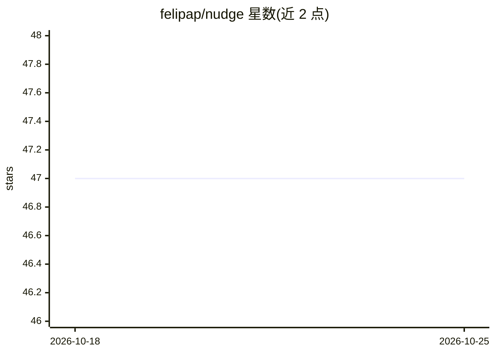

# felipap/nudge

⭐ 47 · TypeScript · GPL-3.0 · 推送 2026-05-07 · [GitHub](https://github.com/felipap/nudge) · [官网](https://nudge.fyi) · 个人维护

**macOS 专注守护应用：AI 监测屏幕并在分心时提醒**

macOS 桌面应用（Electron/TypeScript）：用户设定活动与时长（如'写一小时代码'），应用每分钟截屏并发送给多模态模型（如 GPT-4o-mini）判断是否在做所选活动，检测到分心时发送通知。默认使用用户自有 OpenAI API key；无 key 用户可经 nudge.fyi 代理的 Nudge Cloud（每月免费 20 session-hours）。暂不支持其他 AI 后端。截图会发送给 OpenAI，作者声明代理端不留存截图。以 DMG 安装包形式分发，GPL-3.0 许可。

## 筛选速览

| 维度 | 判定 | 备注 |
|---|---|---|
| AI 角色 | `ai-native` | 本体是模型或模型工具 |
| 许可风险 | `viral` | GPL-3.0 |
| 部署形态 | `desktop` | 安装包/桌面程序 |
| 模型依赖 | — | README 未给出锁定关系 |
| 硬件要求 | — | 无带数字的原话,不猜 |
| 安装摩擦 | `low` | 无编译、无系统依赖或容器化 |
| 成熟度 | — | 结构信号不足 |

## 能力要点

- 每分钟截屏 + 多模态模型判断当前活动是否匹配专注目标
- 分心时发送系统通知
- 支持自有 OpenAI key 或 Nudge Cloud 代理（nudge.fyi）两种模式
- 检测代码位于 main/src/ai/openai/assess-capture/index.ts，可审查

## 适用场景

- 我想在工作时段保持专注，分心时收到提醒
- 我没有 OpenAI key，想通过免费代理使用屏幕专注监测
- 我想设定活动与时长，让 AI 监督自己是否在做事

## 场景标签

 · 领域:个人生产力/桌面工具

## 证据(README 行号)

> L17: Nudge is an app for macOS that watches your screen and helps you stay in flow. Describe an activity and a duration 
> L33:  During a focus session, Nudge takes screenshots every minute and asks a multimodal AI (e.g., GPT-4o-mini) whether 

## 星数曲线

2026-10-18 47 → 2026-10-25 47（+0）

---
*卡片 v1 · prompt 1.4 · 生成 2026-10-25 · 置信度 high · 依据 README sha `ad48f307acae` · [字段定义](../../DATASET.md)*
