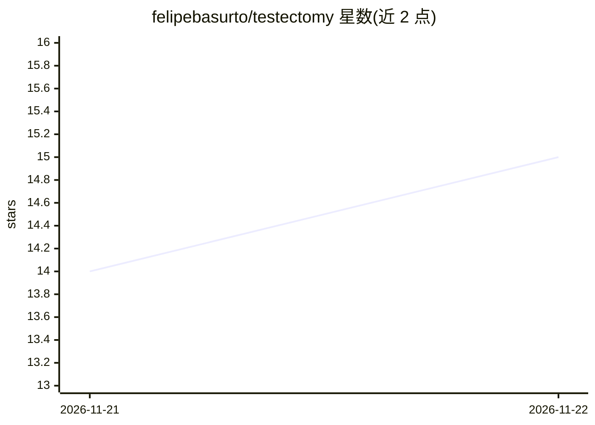

# felipebasurto/testectomy

⭐ 15 · NOASSERTION · 推送 2026-11-18 · [GitHub](https://github.com/felipebasurto/testectomy) · 个人维护

**给 AI agent 用的测试治理技能：修剪低价值测试并沉淀 SPEC.md**

以 Agent Skills 格式分发的测试治理技能，装入 Claude Code、Cursor、Codex、Gemini CLI 等编码 agent 后运行。三种模式：写入时拦截低价值测试的 Gate、按路径执行完整修剪的 Pass、面向大仓库分块推进的 Campaign。机制包括把意图写入 SPEC.md 规则（带编号与检查方式）、按 6 条保留标准对每个测试给出 Keep/Fix/Convert/Fold/Delete 判定、对保留测试做 bite-check（破坏代码验证其能失败），并把代码与意图的矛盾标记为预期失败并列为 bug 报告。技能本身不含脚本，支持任意语言/测试框架。

## 筛选速览

| 维度 | 判定 | 备注 |
|---|---|---|
| AI 角色 | `ai-ecosystem` | LLM/agent 周边工具 |
| 许可风险 | `none` | NOASSERTION |
| 部署形态 | `library` | 以包/库形式分发 |
| 模型依赖 | — | README 未给出锁定关系 |
| 硬件要求 | — | 无带数字的原话,不猜 |
| 安装摩擦 | `low` | 无编译、无系统依赖或容器化 |
| 成熟度 | — | 结构信号不足 |

## 能力要点

- 三种模式：写入时 Gate 拦截、Pass 完整修剪、Campaign 大仓库分块推进
- 6 条保留标准（外部边界、资金/安全、并发/时间、解析器、真实回归、公共契约）逐测试判定
- bite-check：主动破坏代码验证每个保留测试能以断言失败
- 意图沉淀为带编号规则的 SPEC.md，并写入 AGENTS.md 约束后续 agent

## 适用场景

- 清理 agent 写出的重复、断言常量、mock 被测函数的低价值测试
- 把散落在测试里的业务意图整理成 SPEC.md 规则
- 找出绿色测试套件掩盖的真实 bug 并标记为预期失败
- 大型仓库按子系统分块推进测试修剪并留审计台账

## 场景标签

`编码 Agent` · 领域:编码与开发

## 证据(README 行号)

> L3:  One agent skill for tests: it stops low-value tests at write time, cuts an existing suite down to the tests that ma
> L7:  Agent Skills format
> L32: With no argument it works on the whole repo, one area at a time. Codex uses `$testectomy`, the Claude Code plugin u

## 星数曲线

2026-11-21 14 → 2026-11-22 15（+1）

---
*卡片 v1 · prompt 1.4 · 生成 2026-11-21 · 置信度 high · 依据 README sha `97a2ae161849` · [字段定义](../../DATASET.md)*
