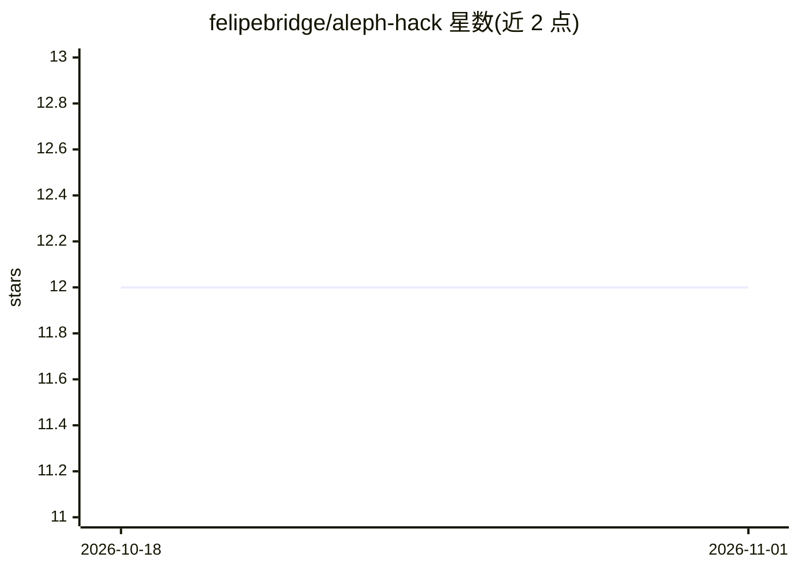

# felipebridge/aleph-hack

⭐ 12 · Python · MIT · 推送 2026-09-14 · [GitHub](https://github.com/felipebridge/aleph-hack) · 组织维护

**面向小型会计所的本地财务对账 Agent：票据与银行流水核验**

Aleph Hackathon 2026 的参赛项目（Tether QVAC 赛道）：自动将客户收据与银行对账单核对，标记金额不符、缺失、重复收据与未解释扣款。OCR 与匹配全部本地运行——OCR 使用 QVAC 视觉模型在设备端执行，匹配基于 pandas 与 RapidFuzz，生成 txt/html 报告；仅 WhatsApp 收件路径经由 Meta WhatsApp Business API 中转，可改用本地文件夹模式完全离线。提供 CLI、本地 Web UI 与 webhook 三种入口，低置信度 OCR 结果标记人工复核而非强制匹配。

## 筛选速览

| 维度 | 判定 | 备注 |
|---|---|---|
| AI 角色 | `ai-native` | 本体是模型或模型工具 |
| 许可风险 | `permissive` | MIT |
| 部署形态 | `library` | 以包/库形式分发 |
| 模型依赖 | — | README 未给出锁定关系 |
| 硬件要求 | — | 无带数字的原话,不猜 |
| 安装摩擦 | `low` | 无编译、无系统依赖或容器化 |
| 成熟度 | — | 结构信号不足 |

## 能力要点

- OCR 与匹配 100% 本地运行（QVAC 视觉模型），财务数据不出本机
- 五种核对结果：clean match / AMOUNT_MISMATCH / MISSING_IN_BANK / DUPLICATE_RECEIPT / UNACCOUNTED_CHARGE
- 支持本地文件夹与 WhatsApp 两种收据来源，CLI 带日期/金额容差等参数，CRITICAL 差异时退出码 2 可用于 cron/CI
- 测试中 QVAC 与 Meta API 均 mock，无需凭据或网络

## 适用场景

- 每月自动核对客户收据与银行流水，找出重复扣款和不明费用
- 在数据受职业保密约束、不能上云的约束下做本地对账
- 通过 WhatsApp 接收客户票据照片并自动进入对账流程

## 场景标签

`OCR` · 领域:感知与多模态

## 证据(README 行号)

> L7: An agent for small accounting firms: it reconciles client receipts against bank statements and flags billing errors 
> L22: receipts (folder or WhatsApp) → OCR (QVAC, local) → extractor → matcher (vs. bank CSV) → report (txt/html)
> L25: **Local, always:** OCR (QVAC vision model on-device), matching (pandas + RapidFuzz), report generation.

## 星数曲线

2026-10-18 12 → 2026-11-01 12（+0）

---
*卡片 v1 · prompt 1.4 · 生成 2026-11-01 · 置信度 high · 依据 README sha `5e9fa39d3967` · [字段定义](../../DATASET.md)*
