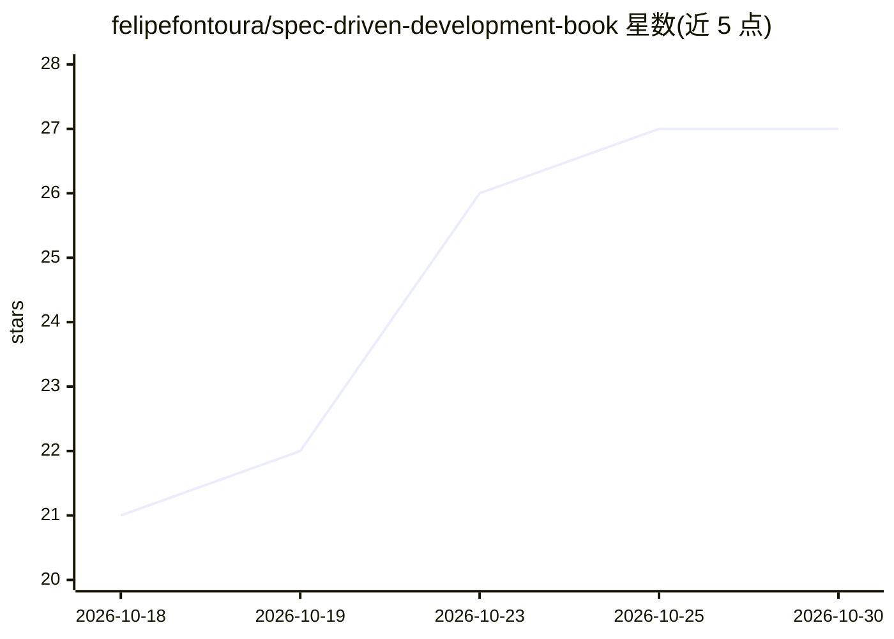

# felipefontoura/spec-driven-development-book

⭐ 27 · NOASSERTION · 推送 2026-10-21 · [GitHub](https://github.com/felipefontoura/spec-driven-development-book) · [官网](https://felipefontoura.com/get/sdd-book/?utm_source=github&utm_medium=referral&utm_campaign=sdd-book&utm_content=about) · 个人维护

**规范驱动开发（SDD）实践书籍：教人用 AI 代理交付软件**

以 Markdown 编写、提供 PDF/EPUB 排版的 SDD 实践书，英文与巴西葡语双语。内容涵盖 IDEA→REQUIREMENTS→TASKS→IMPLEMENTATION 流水线、EARS 需求语法、人工审批门与 .status 文件机制、Claude Code 三层上下文系统，以及 13 应用 70 天交付的金融科技案例。随书附带可用于 Claude Code 的 SDD 工具包：10 个 /sdd-* 技能与 3 个子代理，以 Agent Skills 格式提供并可移植到 Cursor、Codex 等 30+ 工具。书籍许可 CC BY-NC-SA 4.0，工具包 MIT。

## 筛选速览

| 维度 | 判定 | 备注 |
|---|---|---|
| AI 角色 | `ai-knowledge` | 知识聚合/清单类 |
| 许可风险 | `none` | NOASSERTION |
| 部署形态 | `None` |  |
| 模型依赖 | locked-api |  |
| 硬件要求 | — | 无带数字的原话,不猜 |
| 安装摩擦 | `low` | 无编译、无系统依赖或容器化 |
| 成熟度 | — | 结构信号不足 |

## 能力要点

- 完整 SDD 方法论书籍（EN + pt-BR，Markdown 源码 + PDF/EPUB）
- 附带 10 个 /sdd-* 技能与 3 个子代理的 Claude Code SDD 工具包（MIT）
- EARS 需求语法、人工审批门与 .status 文件执行机制
- 13 应用 70 天生产案例与团队级 SDD 实践

## 适用场景

- 学习如何用结构化规范驱动 AI 代理写代码
- 把 SDD 工具包复制进项目，用 /sdd-* 命令运行规范流水线
- 团队建立共享规范、PR 评审与可见审批门的 AI 辅助工作流

## 场景标签

`教程课程` · 领域:学习与行业

## 证据(README 行号)

> L5: A complete, practitioner's book on Spec-Driven Development (SDD) — the method that
> L116: The book ships with a working kit that turns the method into an enforceable
> L117: workflow for **Claude Code** — ten `/sdd-*` skills and three sub-agents, in the

## 星数曲线

2026-10-18 21 → 2026-10-30 27（+6）

---
*卡片 v1 · prompt 1.4 · 生成 2026-10-26 · 置信度 high · 依据 README sha `1120ac2002b0` · [字段定义](../../DATASET.md)*
